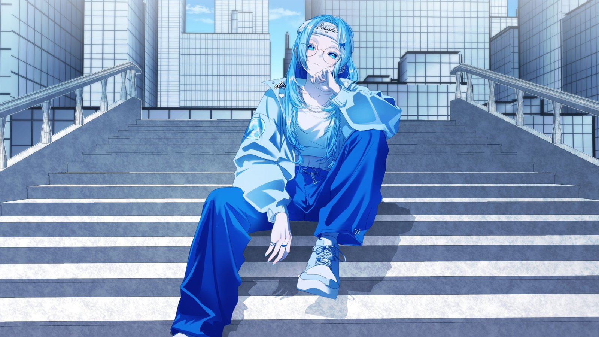

## 1막 · 문을 열며

Q. 처음 만나는 분들께 자기소개 부탁드려요.

안녕하세요! 치지직에서 토크 위주로 방송하고 있는, 하늘섬 출신 구름에서 태어난 구름곰돌이 베이야라고 합니다. 만나서 반가워요~!

Q. '베이야'라는 활동명은 어떻게 짓게 됐나요?

사실 이름에 특별한 뜻이 있는 건 아니에요(웃음). 방송을 시작하기 전, 처음 온라인에서 쓸 닉네임을 고민하고 있었는데 마침 옆에 딸기 맛 간식이 있었거든요. 그래서 '베리'라고 지었어요. 그게 조금씩 변해서 '베이'가 됐고, "베이야~" 하고 부르다 보니 자연스럽게 이름 자체가 '베이야'가 됐답니다.

Q. 방송을 처음 켜던 날을 기억하나요?

저는 방송을 시작한 이유가 '지인들이랑 재밌게 놀려고'였어요. 다른 분들처럼 아바타를 만들고 "저 데뷔합니다!" 하고 시작한 게 아니라, 아무것도 없는 까만 화면에 마이크만 연결해서 방송했어요. 누구나 들어올 수 있는 단체 채팅방 같은 느낌이었죠.

그러다 화면이 너무 심심하니까 일러스트를 넣고, 움직이면 좋겠다 싶어서 아바타를 만들어 띄우고, 까만 배경에 아바타만 있으니 이상해서 방송 배경도 넣고… 그렇게 하나씩 더해 가다 보니 어느새 여기까지 오게 된 것 같아요.

## 2막 · 세상 속으로

Q. 처음 오는 분께 "내 방송은 이런 곳"이라고 소개한다면요?

토크를 메인으로 노래, 게임, 작업 방송까지 다양하게 하고 있고, 유튜브에서는 노래를 부르고 있어요. 토크가 메인인 데다 목소리도 중저음이다 보니 "잔잔한 라디오 같다"는 이야기를 많이 들어요. 부담 없이 잠시 쉬어 갈 수 있는 방송이라고 생각해 주시면 좋겠어요.

Q. 캐릭터의 세계관과 설정(RP)을 소개해 주세요.

저는 원래 하늘섬 출신이에요. 하늘섬에 있는 구름에서 태어난 구름곰돌이죠. 어느 날 하늘섬에서 아래를 내려다보는데, 저 아래 보이는 땅이 너무 궁금해서 내려가 보고 싶어졌어요. 그런데 곰돌이라 하늘을 날 수가 없잖아요. "어떡하지, 어떡하지" 하다가 같은 하늘섬 출신인 하늘다람쥐들의 도움을 받아 땅으로 내려오게 됐어요. 그 하늘다람쥐들이 바로 지금의 베밀리예요.

설정을 만들 때는 제가 좋아하는 걸 담고 싶었어요. 원래 하늘색이랑 구름처럼 몽글몽글한 느낌을 정말 좋아하거든요. 그 둘을 자연스럽게 섞다 보니 '구름곰돌이'라는 설정이 생겨났어요.

> 하늘을 날 수 없는 곰돌이라서, 하늘다람쥐들의 도움을 받아 땅으로 내려왔어요.

Q. 시청자 애칭 '베밀리'에는 어떤 뜻이 담겨 있나요?

제 이름 '베이야'와 가족을 뜻하는 '패밀리'를 합친 이름이에요. '베이야의 가족들'이라는 뜻이죠.

Q. 베이야 방송에서만 볼 수 있는 콘텐츠가 있다면요?

제 방송에서만 볼 수 있는 건지는 모르겠지만(웃음), 저는 게임을 막 즐기는 편은 아니에요. 3D 멀미도 심한 편이고, 한 판에 30분, 1시간씩 붙잡고 있어야 하는 게임은 조금 부담스럽더라고요. 그래서 사과 게임, 레몬 게임처럼 간단한 게임을 토크와 함께 해요. 숫자를 합쳐 10을 맞춰서 없애고 점수를 내는 게임이에요.

토크를 한참 하다가 "슬슬 마무리할 타이밍이다" 싶으면 레몬 게임을 딱 켜고, "오늘은 몇 점 달성하면 방종할게요!" 하고 방종을 거는 거예요. 시청자분들이 이걸 꽤 재밌는 포인트로 봐주시는 것 같아요.

Q. 지금까지 방송하면서 가장 잊히지 않는 장면은요?

방금 말씀드린 레몬 게임이랑 관련된 일이에요. 얼마 전에도 평소처럼 방송 종료 시점을 걸고 레몬 게임 점수 켠왕을 했는데, 하필 목표 점수를 조금 높게 잡았어요. 그런데 시청자분들이 저를 방해하려고 영상 후원을 계속 보내시는 거예요. 거기에 시선을 뺏기는 바람에, 원래 예정보다 2시간 반이나 늦게 방송을 종료하게 됐어요.

나중에는 시청자분들도 "그냥 방송 종료해라, 피곤할 텐데 들어가라" 하셨어요. 작년의 저였다면 "안 되겠다, 그냥 방송 종료할게요~" 했을 것 같은데, 약속한 거니까 끝까지 매달렸고, 결국 성공해서 아주 후련한 마음으로 마무리했어요. 그때 '아, 나 조금 성장했나?' 하는 생각이 들면서 뭔지 모를 뿌듯함을 느꼈던 기억이 나요.

> 작년의 저였다면 중간에 포기했을 거예요. 그 날은 약속을 지키고 싶었어요.

Q. HGE Creator 콜라보로 플레이한 게임 중 기억에 남는 게임은요?

저는 원래 게임을 즐기는 편이 아니라서, 혼자 하면 금방 흥미가 떨어지더라고요. 그래서 다른 분들과 같이 했던 게임이 기억에 남는데, 그중에서도 'Quiet'가 가장 기억에 남아요. 오리로 변신해서 다른 분들과 협력해 미션을 클리어하고, 몹을 피해 숨고 도망치는 게임인데요. 같이 하다 보니 케미가 터지면서 재밌는 장면이 정말 많이 나왔어요. 게임을 즐기는 편이 아닌데도 플레이하는 내내 웃었던 기억이 나요.

## 3막 · 다음 장으로

Q. 앞으로 이 방송이 어떤 곳이 되었으면 좋겠나요?

저는 주력으로 미는 특별한 콘텐츠가 있는 방송은 아니에요. 하지만 그렇기 때문에 오히려 다양한 분들이 편하게 즐기실 수 있는 방송이 될 수 있다고 생각해요. 앞으로도 많은 분들의 하루에 작은 즐거움이 될 수 있었으면 좋겠어요!

Q. 언젠가 꼭 해보고 싶은 꿈의 방송이 있다면요?

지금은 Live2D 아바타로 방송하고 있는데요. 저뿐만 아니라 모든 스트리머의 꿈일 것 같은데, 언젠가는 오리지널 3D를 제작해서 모션캡처나 풀 트래킹 콘텐츠를 꼭 해보고 싶어요. 제가 본업이 태권도 사범이었고 춤도 좋아하다 보니, 풀 트래킹으로 보여드릴 수 있는 게 정말 많을 것 같거든요!

---

베이야의 노래가 궁금하다면, 오리지널 곡부터 들어보세요.

https://www.youtube.com/watch?v=TR7JB5IbL0w

Q. 이 인터뷰를 읽고 처음 방송에 들어올 분들께 한마디 해주세요.

부족한 저를 응원해 주시는 모든 분들, 그리고 베밀리분들께 진심으로 감사드려요. 앞으로 더 다채롭고, 재밌고, 편안한 방송으로 찾아뵐 테니 옆에서 지켜봐 주세요! 감사합니다!
