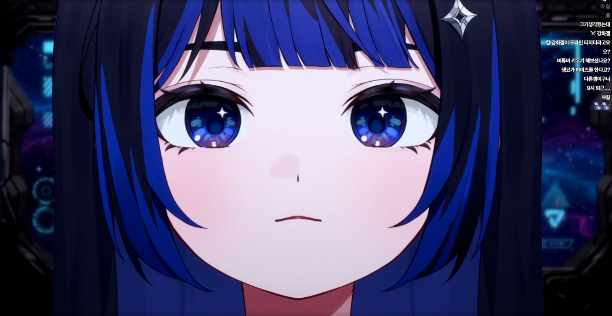

## 1막 · 문을 열며

Q. 처음 만나는 분들께 자기소개 부탁드려요.

데뷔 때 했던 인사로 해 볼게요!

"안녕하십니까! 깊은 우주 속 수많은 신호를 관리하는 노크티아 행성에서 온, 지구 수신호 전담 관리자 초댕코입니다. 현재 지구와 신호를 연결해 치지직과 유튜브라는 채널을 통해 지구인 여러분과 소통하고 있습니다. 토크, 게임, 노래 등 지구인들이 좋아하는 다양한 콘텐츠를 신호로 보내며 즐거운 교신을 이어 가고 있습니다!"

Q. '초댕코'라는 활동명은 어떻게 짓게 됐나요?

이거 살짝 걱정하고 있었는데요(웃음). 솔직히 이 이름에는 뜻이 없어요! 그래서 팬분들께 설명할 때도 항상 "태어나 보니 초댕코였다"라고 해요.

계속 이름을 고민하면서 지인들, 친구들한테 추천도 받았는데, 그중에 '댕코'라는 이름이 너무 귀엽고 저랑 잘 어울리는 것 같더라고요. 성이 '초'인 건 그냥 특이해서요. 둘을 합쳐 보니 "초댕코, 나쁘지 않네?" 해서 바로 정했어요. 진짜 뜻 없어요(웃음).

Q. 방송을 처음 켜던 날을 기억하나요?

아주 생생하게 기억나요. 그런데 사실 저한테는 살짝 기억하고 싶지 않은 날이에요(웃음). 지금은 컴퓨터를 바꿨는데, 그때 쓰던 게 일명 '똥컴'이었거든요. 데뷔 방송 내내 컴퓨터가 엄청 버벅거려서 정말 힘들게 진행했어요. 분명 대본도 써 놨는데 긴장해서 제대로 읽지도 못하고 "어, 어, 어…" 하고 있었고요.

지금도 다시 보기를 보면 너무 부끄러워요. 그래도 그때와 비교하면 지금 정말 많이 성장했다는 게 느껴져서, 그건 좀 짜릿해요. 그때의 실수 덕분에 성장한 모습을 보여 드릴 수 있는 거니까요.

## 2막 · 세상 속으로

Q. 처음 오는 분께 "내 방송은 이런 곳"이라고 소개한다면요?

친구, 혹은 친한 동생이랑 시간을 보내는 것 같은 편안함을 느낄 수 있는 방송이라고 소개하고 싶어요.

굳이 특별한 이야기가 아니어도 자연스럽게 대화에 낄 수 있어서, 편하게 들어와서 보실 수 있어요. 저는 방송에서 항상 "오늘 밥 뭐 먹었어? 오늘 재밌는 일 있었어?" 하고 먼저 말을 걸어요. 소소한 일상부터 장난스러운 이야기까지, 시청자분들도 저한테 똑같이 물어봐 주시면서 거리낌 없이 대화하는 분위기예요.

https://youtu.be/isRG7AtWWlI

Q. 캐릭터의 세계관과 설정(RP)을 소개해 주세요.

노크티아 행성은 수많은 우주의 행성들이 보내는 수신호를 관리하고 연결해 주는, 아주 중요한 역할을 하는 행성이에요. 저는 그곳 제3관측소에서 여러 행성 중 '지구'를 전담으로 관리하는 통신 관리자고요.

원래 제 임무는 수신호를 관리하고 보고하는 것뿐이에요. 그런데 제가 장난기가 좀 많다 보니(웃음), 다른 행성보다 신호가 유난히 많은 지구가 너무 신비롭게 느껴졌어요. 그래서 공식 보고에는 없는 비공식 교신 채널을 몰래 파서 지구인들과 소통하기 시작했죠. 그게 바로 제 방송이에요. 그러니까 저는 지구에 내려온 게 아니라, 지금도 노크티아 행성에서 몰래 교신하고 있는 거예요!

> 공식 보고에는 없는 비공식 교신 채널을 몰래 파서, 지구인들과 소통하고 있어요.

Q. 시청자를 부르는 애칭이 있나요?

이것도 조금 부끄러운데요(웃음), 팬 애칭은 '지동구'예요. 이것도 솔직히 뜻은 없어요!

저는 팬 캐릭터를 먼저 만들었어요. 이름을 정하고 거기에 맞춰 디자인하기보다는, 제가 좋아하는 것들로 캐릭터를 만들고 거기에 어울리는 이름을 지어 주고 싶었거든요. 그래서 제가 좋아하는 동물인 웜뱃으로 팬 캐릭터를 만들었는데, 생긴 걸 보면 바로 '동구'라는 이름이 떠오를 정도예요. 얘도 그냥 태어날 때부터 동구였던 것 같아요. 운명 아닐까요?(웃음)

Q. 초댕코 방송에서만 볼 수 있는 콘텐츠가 있다면요?

특별한 콘텐츠는 솔직히 아직 없다고 생각해요. 그래도 확실한 건, 다른 방송에 비해 많이 시끄럽다는 거예요(웃음). 그런데 그게 피곤한 시끄러움이 아니라, 친한 동생을 보듯이 "아이고 재밌다" 하면서 귀엽게 봐 줄 수 있는 화기애애한 시끄러움이에요. 그건 보장할 수 있어요!

Q. 지금까지 방송하면서 가장 기억에 남는 해프닝은요?

저희 집이 신호가 너무 안 좋아서, 방송하다가 가끔 차단기가 내려가요. 지금은 시청자분들도 익숙해서 "아, 또 차단기 내려갔구나" 하시는데요.

한번은 방송 중에 차단기가 내려가서 다시 켜고 "안녕하세요! 아, 미안해요!" 하자마자 또 내려간 거예요. 그래서 그대로 방송이 끝나 버렸어요(웃음). 

Q. HGE Creator 콜라보로 플레이한 게임 중 기억에 남는 게임은요?

콜라보를 세 번 했는데, 그중에서 '귀귀살전'이 제일 재밌었고 기억에 남아요. 저는 그때까지 합방을 제대로 해 본 적이 없고, 게임도 주로 혼자 하는 1인 게임 위주로 했거든요. 그런데 귀귀살전 콜라보 덕분에 다른 버츄얼 스트리머분들과 합방을 하게 됐고, 많은 분들을 알게 됐어요.

## 3막 · 다음 장으로

Q. 앞으로 시청자들에게 어떻게 기억되고 싶나요?

항상 하는 이야기지만, 진짜 친한 사람들이랑 같이 놀고 이야기하는 것처럼 웃고 떠들면서 편하게 있을 수 있는 공간이 되는 게 목표예요. 그리고 힘들었던 분들, 슬픈 분들에게 위로가 될 수 있는, 좋은 분위기의 방송을 만들어 가고 싶어요.

> 힘들고 슬픈 분들에게 위로가 될 수 있는, 좋은 분위기의 방송을 만들어 가고 싶어요.

Q. 언젠가 꼭 해보고 싶은 꿈의 방송이 있다면요?

오리지널 3D를 꼭 만들어서, 저의 미친 텐션과 끼를 제대로 보여 드리고 싶어요. 오리지널 3D로 꼭, 꼭, 꼭 재밌는 콘텐츠를 보여 드릴 거예요!

Q. 이 인터뷰를 읽고 있을 지동구들에게 한마디 해주세요.

안녕, 미래의 300만 동구들아! 앞으로도 내 신호 잘 받고 재밌게 놀아 보자잉. 내가 사랑한다는 말은 잘 안 하지만, 항상 사랑하고… 누구보다, 진짜 누구보다, 누구보다, 누구보다… 여기까지!
