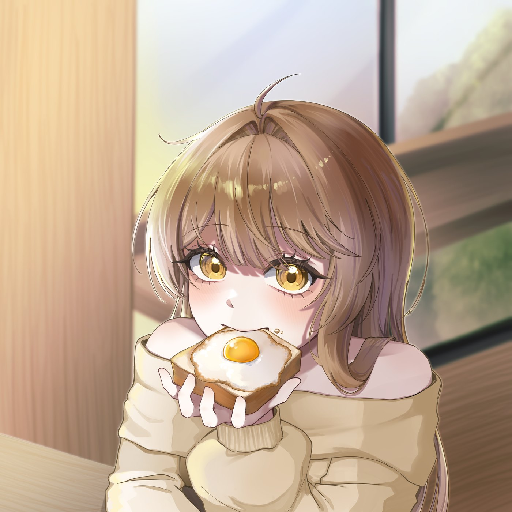

## 1막 · 문을 열며

Q. 처음 만나는 분들께 자기소개 부탁드려요. 어떤 걸 만드는 사람인가요?

잠시만요! 너무 긴장돼서(웃음)… 소개를 어디 가서 해 볼 일이 없다 보니까요. (호흡을 가다듬고) 안녕하세요, 트위터에서 그림을 그리고 있는 일러스트레이터 코유라고 합니다.

주로 방송 업계에서 사용될 만한 그림들을 그리고 있고, 버추얼 업계에서 활동하고 있어요.

Q. 처음 그림을 시작하게 된 계기가 궁금해요.

사실 그림에 관심이 생긴 건, 기억도 잘 나지 않는 아주 어린 시절부터였던 것 같아요. 그때부터 그림을 정말 좋아했거든요.

그래서 진로 고민도 따로 없었어요. 그냥 당연하게 '나는 이 길을 가야겠다'는 마음으로 지금까지 걸어왔던 것 같아요.

Q. 지금의 그림체를 갖기까지 영향을 준 사람이나 롤 모델이 있나요?

저는 원래 그림을 전문적으로 배우지 않았기 때문에, 제 그림체를 찾기까지 정말 오래 걸렸다고 생각해요.

그러다 어느 순간 홀로라이브의 '하코스 벨즈'라는 버추얼 유튜버분을 좋아하게 됐어요. 그런데 그분을 좋아하는 걸 넘어서, 그분의 모델을 전반적으로 디자인한 일러스트레이터분에게까지 관심이 가더라고요. 그렇게 순전히 팬심으로 검색해서 알게 된 분이 미카 피카조(Mika Pikazo) 님이에요.

그분의 그림을 보고 '아, 이게 내가 그리고 싶었던 그림이구나' 하는 걸 처음으로 깨달았어요. 그 뒤로 제 추구미도 점점 그분의 그림과 비슷하게 변해 왔던 것 같아요.

> '이게 내가 그리고 싶었던 그림이구나' 하고 처음으로 깨달았어요.

*편집자 주* — 미카 피카조(Mika Pikazo)는 홀로라이브 English 소속 버추얼 유튜버 하코스 벨즈의 캐릭터 디자인을 맡은 일러스트레이터다. 선명한 색감과 힘 있는 선으로 잘 알려져 있다.

## 2막 · 세상 속으로

Q. 주로 어떤 작품을 만들고 있나요?

보통 스트리머분들이 방송에서 사용할 수 있는 요소들을 작업하고 있어요. 대표적으로 버추얼 모델이나 짚톡, 커버송 일러스트처럼, 방송을 통해 사람들에게 전해지는 그림을 그리고 있습니다.

Q. 스트리머나 다른 크리에이터와 함께 작업해 본 적이 있나요? 기억에 남는 순간은요?

일러스트레이터 활동을 시작한 뒤로 꾸준히 다양한 스트리머분들의 여러 작업을 맡아 왔어요. 주 고객이 방송인이다 보니 제 그림이 쓰이는 곳도 방송 업계인데요. 그래서 여러 방송 플랫폼에서 제 그림을 어렵지 않게 찾아볼 수 있다는 게 정말 신기하고, 지금도 인상 깊어요.

특히 버추얼의 경우는 모델이 방송의 핵심 요소잖아요. 제 손을 거친 모델을 버추얼 유튜버분들이 사용해 주시는 걸 보면 정말 뿌듯해요. 그리고 그 모델을 좋아해 주시는 팬분들의 채팅을 볼 때면, 그게 또 큰 기쁨이 되는 것 같아요.

Q. 작품을 본 사람에게 들은 말 중 가장 힘이 됐던 한마디는요?

제 그림이 전체적으로 귀여운 그림체라서 "귀엽다"는 말을 정말 많이 들어요. 그런데 그냥 귀엽다를 넘어서, "지인한테도 추천할게요!" 하시는 분들이 계세요.

나만 쓰는 게 아니라 친한 친구들에게도 소개해 주고 싶다는 마음이잖아요. 그런 분들의 메시지가 가장 기억에 남아요.

Q. 작업할 때 꼭 지키는 나만의 원칙이나 고집이 있나요?

그림을 그리는 방식은 여러 가지가 있는데요. 저는 무조건 선화를 먼저 작업하고, 그다음에 채색을 해요. 이건 정말 무조건적으로 고집하고 있는 부분이에요.

앞서 말씀드린 롤 모델분의 그림도 선화가 중심이 되는 스타일이라, 어느 순간부터 자연스럽게 저만의 규칙이 된 것 같아요. 또 방송에 노출되는 그림들이다 보니, 선이 명확해야 시청자분들 눈에도 확 들어온다고 생각해요.

> 방송에 나오는 그림이니까, 선이 명확해야 시청자분들 눈에도 확 들어온다고 생각해요.

## 3막 · 다음 장으로

Q. 앞으로 어떤 일러스트레이터로 기억되고 싶나요? 1년 뒤, 5년 뒤의 모습을 그려 본다면요?

방송을 좀 본다 하는 분이라면, '어디선가 한 번쯤 봤던 그림체'로 기억되고 싶어요.

제가 주로 활동하는 곳이 방송 쪽이다 보니, 시청자분들이 저라는 사람은 몰라도 제 그림을 보고 "어? 이 그림 어디서 본 것 같은데?" 하고 느끼실 수 있는, 그런 일관성 있고 영향력 있는 일러스트레이터가 되고 싶어요.

Q. 이 인터뷰로 코유 님을 처음 만나는 분들께 한마디 해주세요.

안녕하세요, 일러스트레이터 코유라고 합니다! 저는 완성형이 아닌 성장형 일러스트레이터라고 할 수 있는데요. 실제로 아주 오래전부터 활동해 왔기 때문에, 제 트위터에서는 제가 성장해 온 모습을 보는 재미가 쏠쏠하답니다. 오히려 성장이 빠르지 않고 천천히 바뀌어 가기 때문에, 살짝 육성하는 기분으로 지켜보기 좋지 않을까 싶어요(웃음).

업로드가 잦은 계정은 아니지만 자잘하게 소통도 하고 있고요. 다양한 방송인분들의 작업을 많이 진행하고 있어서, 여기저기서 제 그림을 찾아보는 재미도 있으실 거예요.

아직 유명하진 않지만, 엄청 유명해지는 그날까지 천천히 계단을 하나씩 오르는 일러스트레이터가 되겠습니다!
