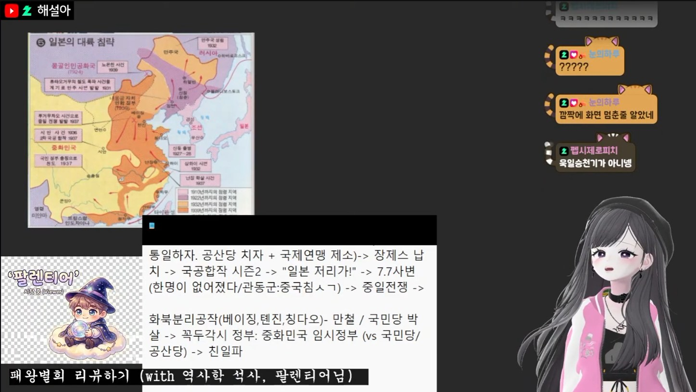

## 1막 · 문을 열며

Q. 처음 만나는 분들께 자기소개 부탁드려요.

해하! 안녕하세요, 명문 S대 · 대기업 L사 · 영미권 석사 출신! 사람과 문화를 해설하는 버튜버, 해설아입니다.

게임부터 역사, 심리, 철학, 대중문화까지 다양한 주제를 다루고 있어요. 이야기 나누는 걸 정말 좋아해서, 강의처럼 진지한 이야기를 하다가도 어느새 게임하면서 수다를 떨고 있곤 해요. 지적인 허영심을 채우고 싶은 분들께(웃음) 게임처럼 가볍게 다가가는 방송이랄까요. 아는 것도 많고 하고 싶은 것도 많은 사람입니다. 잘 부탁드려요!

Q. '해설아'라는 이름은 어떻게 탄생했나요?

이름 그대로 '해설하는 사람'이라는 뜻이에요. 버튜버라고 하면 대부분 게임이나 노래를 하시잖아요. 그래서 "다른 분들에 비해 내 강점은 뭘까?" 고민했는데, 저는 제가 가진 경험이나 지식을 해설하는 걸 정말 좋아하더라고요. 무언가를 설명하고 지식을 나누는 일이 즐거워요.

그래서 '해설을 잘하자, 해설하는 사람이 되자' 해서 해설아가 됐어요. 찾아보니 아직 이 이름으로 활동하는 분도 없었고요. 사람을 해설하고, 제 전공이었던 문화를 해설하고, 때로는 게임도 해설하는 방송입니다.

Q. 방송을 처음 켜던 날을 기억하나요?

당연히 기억하죠! 방송에서도 잠깐 이야기한 적이 있는데, 사실 처음에는 데뷔할 생각이 없었어요. 원래 데뷔하시려던 분이 따로 계셨고, 저는 프로듀서로만 활동하려고 했거든요. 그런데 일이 어그러지면서 어쩌다 보니 제가 직접 데뷔하게 됐어요.

생각지도 못한 걸 하려니까 너무 긴장되더라고요. 원래는 밤 10시, 11시쯤 데뷔 방송을 하려고 했는데, 진짜 토가 나올 것 같고 심장이 입 밖으로 튀어나올 것 같아서 결국 접고 침대에 누웠어요. 그래도 칼을 뽑았으면 무라도 썰어야겠다 싶어서, 새벽 3시에 다시 일어나 반쯤 비몽사몽한 상태로 방송을 켰어요.

첫 방송 주제는 뉴욕 터미널에서 노숙했던 썰이었어요. 일단 관심을 끌어 보자 싶었는데, 아무도 모르는 사람들 앞에서 혼자 원맨쇼를 하려니 "과연 재미있을까, 누가 와 주실까" 걱정이 많았죠. 저는 아무도 안 오실 거라고 확신했거든요. 그런데 새벽 3, 4시인데도 한두 분이 찾아와 주셨고, 채팅창도 제대로 못 보는 저랑 계속 이야기를 나눠 주셨어요. 그게 너무 재밌어서 다음 날에도 자연스럽게 방송을 켰고, "어쩌면 이거 될 수도 있겠다" 하는 생각이 들었어요.

> 칼을 뽑았으면 무라도 썰어야겠다는 마음으로, 새벽 3시에 다시 일어나 방송을 켰어요.

## 2막 · 세상 속으로

Q. 처음 오는 분께 "내 방송은 이런 곳"이라고 소개한다면요?

한마디로 표현하면 지적인 호기심과 엉뚱한 즐거움이 공존하는 곳이에요. 어떤 날은 심리학이나 철학 이야기를 하다가, 어떤 날은 오버워치나 스타크래프트에 과몰입하기도 해요.

"오늘은 또 무슨 인문학 얘기를 하려나?" 하고 오신 분이 게임 구경을 하고 가시기도 하고, 게임 구경하러 왔다가 갑자기 서브컬처 이야기를 배우고 가시기도 해요. 공부하러 왔다가 웃고 가셔도 좋고, 놀러 왔다가 새로운 지식을 얻어 가셔도 좋은, 두 마리 토끼를 다 잡는 방송이에요!

https://youtu.be/kQ37_xU6GLQ

Q. 캐릭터의 세계관과 설정(RP)을 소개해 주세요.

해설아는 이름처럼 세상의 여러 가지를 해설하는 사람이에요. 처음에는 중국 근대사, 미국 근대사, 한국 근대사 같은 역사를 공부하면서 해설했는데, 요즘은 TS, 퍼리, 버미육, 연애 게임 같은 서브컬처 이야기도 많이 하고 있어요. 사람의 심리와 정체성부터 역사, 문화, 게임까지, 관심 있는 분야라면 어디든 찾아가서 해설하죠. 정해진 세계관에 갇혀 있기보다는, 하고 싶은 이야기를 다 들려주는 캐릭터라고 생각해 주시면 좋겠어요.

Q. 시청자를 부르는 애칭이 있나요?

어느 날 보니까 시청자분들이 저를 '달설아'라고 부르고 계시더라고요. 그게 너무 귀여웠어요! 해설아와 달설아, 해님과 달님 하니까 '오누이'가 떠올랐는데, 팬분들을 오누이님이라고 부르기엔 좀 어색해서 줄여서 '온님'이라고 부르게 됐어요. 여러 분이니까 온님들이에요.

Q. 해설아 방송에서만 볼 수 있는 콘텐츠가 있다면요?

시청자분들과 함께하는 해설 콘텐츠를 꼽고 싶어요. 제 강의는 저 혼자 하는 게 아니라, 대부분 시청자분들과 같이 진행하거든요. 처음에는 역사학 석사이신 온님과 함께 진행하면서 제가 배우는 쪽이었어요. 심리학, 철학, 역사, 대중문화를 넘어 서브컬처 주제까지, 전문 지식을 가진 온님분들이 쉽고 재미있게 풀어 주세요. 단순히 정보를 전달하기보다 서로의 관점을 나누는 방송을 지향하고 있어요.

그리고 제가 오버워치를 10년 넘게 했거든요. 실력이 나쁘지 않은 편이라 오버워치를 진지하게 하는 모습도 보여드리고, 상자를 아무리 까도 새 스킨이 안 나오는 콘텐츠도 하고요(웃음). 반대로 스타크래프트는 컴퓨터도 못 이기는 완전 초보라서, 그 두 가지 모습을 다 보여드리고 싶어요.

Q. 지금까지 방송하면서 가장 기억에 남는 해프닝은요?

아무래도 화이트데이에 한국 공포 게임 '화이트데이'를 플레이했던 날이요. 제가 사실 굉장한 겁쟁이라 무서운 장면에서 비명을 질렀는데, 그 순간 컴퓨터가 꺼지면서 방송까지 터져 버린 거예요! 소리를 지르자마자 방송이 꺼졌으니 보시던 분들도 다들 당황하셨죠.

나중에 통신사까지 바꾸고 인터넷 환경을 개선해서 더는 방송이 꺼지는 일이 없지만, 그때는 데뷔한 지 두 달도 안 됐을 때라 정말 식은땀이 났어요. 지금은 웃으면서 이야기할 수 있는 추억이에요.

Q. HGE Creator 콜라보로 플레이한 게임 중 기억에 남는 게임은요?

'얀데레 바이러스'가 가장 기억에 남아요! 보통 콜라보 지원을 받을 때는 게임 을 하나만 받아서 다른 분들과 같이 할 수가 없었는데, 이번에는 여러 개를 받아서 온님들께도 나눠 드리고 시청자 참여형으로 진행할 수 있었어요. 오버워치 말고는 시청자 참여를 해 본 적이 없어서 더 새로웠어요.

그런데 제가 계속 얀데레 바이러스에 감염되는 바람에, 시청자분들을 쫓아다니며 집착하는 역할을 맡게 됐어요. 평소엔 온님들이 저를 따라다니는데, 이번엔 애정 관계가 뒤바뀐 것 같아서 너무 재밌었어요.

특히 강의를 해 주시기로 약속해 놓고 계속 미루시던 온님들이 있었거든요. 그래서 제가 "벌써 12월인데 강의 언제 해 줄 거야?" 하면서 직접 쫓아다니며 독촉했는데, 다들 "다음 주에 해 드릴게요!" 하면서 도망가시는 거예요(웃음). 평소 방송에서는 볼 수 없던 색다른 케미를 보여드릴 수 있어서 더 기억에 남아요.

## 3막 · 다음 장으로

Q. 앞으로 시청자들에게 어떻게 기억되고 싶나요?

다양한 의견을 편견 없이 나눌 수 있는, 토론의 장 같은 방송이 되고 싶어요. 저희 방송에는 "이런 말 하지 마세요, 저런 말 하지 마세요" 하는 금지어가 거의 없거든요. 요즘 청년들이 가진 고민이나 지금의 문화를 같이 해석하면서, 자기 이야기를 자유롭게 할 수 있는 공간이었으면 해요.

단순히 게임을 잘하거나 재미있는 방송을 하는 사람을 넘어서, "해설아를 통해 새로운 관심사나 시각을 발견했다"고 말씀해 주신다면 정말 기쁠 것 같아요.

> 편견 없이 자유롭게 이야기하다 보면, 새로운 생각을 하게 되는 사람으로 기억되고 싶어요.

Q. 언젠가 꼭 해보고 싶은 꿈의 방송이 있다면요?

저희 방에는 역사학 석사분들도 계시고, 심리 쪽에서 실제로 일하시는 분들도 계시고, 연애 게임을 몇백 개씩 해 보신 분들도 계세요. 지금까지는 그분들을 한 강의에 한 분씩 모셨는데, 언젠가는 이 전문가 온님들을 한자리에 모아서 대형 토크쇼나 지식 토크 콘서트를 열고 싶어요. 각자의 전문 분야를 가진 분들이 하나의 주제를 깊이 있게 이야기하는 자리요. 그게 제 꿈의 방송이에요!

Q. 이 인터뷰를 읽고 있을 온님들에게 한마디 해주세요.

여러분, 해설아의 세계에 오신 걸 환영합니다! 세상에는 아직 우리가 모르는 재미있는 이야기들이 정말 많잖아요. 앞으로도 함께 웃고 떠들고, 때로는 진지하게 고민하면서 다양한 이야기를 만들어 갔으면 좋겠어요. 오래오래 함께해 주세요. 사랑합니다! 💗
