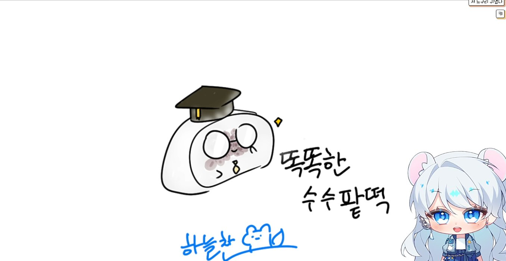

## 1막 · 문을 열며

Q. 처음 만나는 분들께 자기소개 부탁드려요. 방송에서 쓰는 인사말 그대로요!

"늘하! 안녕하세요, 댕청 N 소통, 납치당하기 전문 스트리머 하늘찬입니다!"

주로 이렇게 인사해요!

Q. '하늘찬'이라는 활동명은 어떻게 짓게 됐나요?

제 이름을 보고 '하늘 님'이라고 부르시는 분들이 종종 계신데, 사실 '늘찬'이 맞거든요.

저는 순우리말로 활동명을 짓고 싶어서, 거의 1년 동안 순우리말을 검색했어요. 도저히 안 되겠다 싶어서 다른 예쁜 이름도 찾아봤는데 마음에 드는 이름이 없더라고요. 그래서 마지막이다 하고 한 번 더 순우리말을 찾아보다가 '늘찬'이라는 단어를 발견했어요. '능란하고 재빠르다', '옹골차다'라는 뜻인데 의미도 너무 마음에 들었어요.

고민하다가 '내가 하늘을 좋아하니까, 하늘을 넣자!' 해서 하늘찬이 됐답니다!

Q. 방송을 처음 켠 날을 기억하나요?

사실 첫날은 치지직이 아니라 트위치에서 시작했어요. 저는 방송을 시작하기 전까지 컴퓨터도 없었고, 컴퓨터 게임을 한 번도 해 본 적이 없는 사람이었어요(웃음). 1년에 컴퓨터를 한두 번 켤까 말까 할 정도였죠. 그래서 제가 방송을 한다고 했을 때 가족들도, 지인들도 정말 놀랐어요.

그러다 게임을 조금씩 접하고 방송이라는 것도 알게 됐는데, 원래 고민 상담이나 사람들과 이야기 나누는 걸 좋아했거든요. 이걸 목표로 삼아서 해 보고 싶다는 생각이 들었고, 다른 스트리머분들의 방송을 보다가 '나도 한번 해 볼까?' 하고 켜게 됐어요.

그날은 '내가 잘할 수 있을까?' 하는 불안감이 제일 컸어요. 그런데 다행히도 제가 자주 보던 방송의 시청자분들이 제가 방송을 켠다는 소식을 듣고 놀러 와 주셨어요. 그 덕분에 불안감이 사르르 풀리면서, '아, 재밌다!' 하는 기억만 남았어요.

그 기억 덕분에 조금씩 해 나갈 수 있었어요. 처음엔 방송 화면 속 그림도 엄청 하찮았는데, 제 캐릭터도 만들고 하나씩 성장해 오면서 지금까지 왔네요.

## 2막 · 세상 속으로

Q. 처음 오는 분께 "내 방송은 이런 곳"이라고 소개한다면요?

제 방송은 일단 소통 중심이에요! 게임을 할 때도, 안 할 때도 소통이 가장 커요.

방송을 켜면 최소 1시간에서 2시간 정도는 시청자분들 한 분 한 분에게 맞춰서 이야기를 나눠요. 이분은 직장인이고, 이분은 학생이니까, 그에 맞춰 질문을 하나씩 꼭 드려요. 평소와 조금 다른 느낌이 들면 "오늘 무슨 일 있었어?", "재밌는 일 있었어?" 하고 먼저 물어보고요.

게임을 하다 보면 "저는 게임 안 해요", "이 게임은 잘 몰라요" 하시는 분들도 계시잖아요. 그런 분들을 위해서라도 꼭 말을 걸고, 오히려 더 많이 질문하는 편이에요. 그래서 저희 방은 게임을 몰라도, 관심이 없어도 '늘찬님이랑 이야기해야지' 하고 머무시는 분들이 많아요.

그리고 제가 시청자분들을 기억하는 기억력이 좋은 편이에요. 시험이나 수능을 준비하느라 1년에 한 번씩 오시는 분들도 계신데, 그분들이 "저를 어떻게 기억하세요?" 하고 놀라세요. 그러다 공부하다 쉬는 시간에 1년에 두 번씩 오시기도 하고, 시험이 끝나면 계속 보고 싶다고 말씀해 주시기도 해요. 그런 분들을 위해서라도 더 오래 기억해야겠다 싶어서 관심을 쏟다 보니, 어느 순간 '소통 전문'이 돼 버렸어요.

> 시험이 끝나면 다시 오겠다는 분들을 위해서라도, 더 오래 기억해야겠다 싶었어요.

https://www.youtube.com/watch?v=Rl_KkhATWXQ

Q. 캐릭터의 세계관과 설정(RP)을 소개해 주세요.

사실 다른 분들보다 RP를 정하는 게 정말 힘들었어요. 이쪽 문화를 전혀 모르는 사람이었거든요. 어떻게 할까 고민하던 중에 "늘찬님은 뭐가 되고 싶으세요?"라는 질문을 받았어요.

솔직히 말하면, 온전한 나라는 사람과 닮은 캐릭터를 하고 싶다는 생각밖에 안 들었어요. 그럼 나랑 닮은 게 뭘까 생각해 보니, 강아지랑 족제비를 닮았다는 말을 많이 들었더라고요. 그래서 족제비로 정했어요.

한국 동물원에는 족제비가 거의 없잖아요. 그래서 동물원이나 보호소에 우연히 들어왔다가 탈출해서, 사람들과 이야기하고 친해지기 위해 세상을 돌아다니는 '여행하는 족제비'로 콘셉트를 잡았어요. 겉으로는 '동물원을 탈출한 족제비'인데, 파고들면 그런 이야기가 있는 거죠. 사실 아직도 RP를 완벽하게 정하진 못했어요(웃음).

Q. 시청자를 부르는 애칭이 있나요?

저희 방 애칭은 '별애기'예요!

애칭을 정하기 전부터 시청자분들을 '애기'라고 많이 불렀어요. 어릴 때부터 친구들이랑 놀면서 '애기'라는 호칭을 자주 쓰던 버릇이 있었는데, 그게 어느 순간 시청자분들한테까지 가더라고요.

그래서 어차피 애기라고 부르는 거, 애기로 하자! 대신 저는 '하늘'이고, 하늘 중에서도 밤하늘을 좋아하거든요. 밤하늘에 뜬 별들이 너무 예쁘니까, 너희는 그 예쁜 별을 따서 '별애기'로 하자 해서 별애기가 됐어요.

번외로, 짓궂은 시청자분들끼리는 스스로를 '쓸애기'라고 부르는 농담도 있어요(웃음).

Q. 하늘찬 방송에서만 볼 수 있는 콘텐츠가 있다면요?

아직까지 하늘찬 방송에서만 볼 수 있는 게임은 없는 것 같아요. 시청자분들이 해 보라고 하는 게임을 주로 하다 보니, 요즘은 '이터널 리턴'을 많이 해요.

그 대신 저희 방송만의 분위기가 있어요. 소통할 때 시청자분들이 두 갈래로 나뉘거든요. 하늘찬을 좋아하지만 엄청 놀리는 '삼촌' 스타일과, 하늘찬을 숭배하는… '종교'라고 하기엔 좀 애매하지만(웃음), 숭배하는 쪽으로요. 한쪽에서 실컷 놀리면, 다른 쪽에서는 '너무 놀렸나?' 하면서 달래 주는 티키타카가 생겨요. 저는 그 모습이 제일 좋아요.

전에 시청자분들께 설문 조사를 한 적이 있는데, 대부분 소통할 때 자기를 기억해 주고 세심하게 챙겨 준다는 점을 꼽아 주셨어요. 그런데 가장 많이 나온 말은 "하늘찬은 타격감이 좋다"였어요. 그래서 저희 방송의 메인은 타격감인 것 같아요(웃음).

## 3막 · 다음 장으로

Q. 앞으로 시청자들에게 어떻게 기억되고 싶나요?

언제든 왔을 때 나를 기억해 주고, 나를 좋아해 줄 수 있는 사람으로 기억되고 싶어요.

시청자분들이 무슨 일이 생겨서, 혹은 수능 같은 일 때문에 한동안 못 오더라도 저는 계속 기억할 거예요. 힘들어서 잠시 없어지더라도, 어느 순간 다시 왔을 때 '나를 기억해 주는 사람이 있다'는 걸 소중하게 느꼈으면 좋겠어요.

제가 방송을 시작한 계기이자 목표가 '나를 기억해 줄 수 있는 사람이 있었으면 좋겠다'였거든요. 그래서 '나도 너를 기억할 테니, 너도 나를 기억해 줘' 하는 느낌으로, 서로를 기억하는 방송이 됐으면 좋겠어요.

> 나도 너를 기억할 테니, 너도 나를 기억해 줘. 서로를 기억하는 방송이 됐으면 좋겠어요.

Q. 이 인터뷰를 읽고 있을 별애기들에게 한마디 해주세요.

우리 애기들이 매일 놀리고 잔소리하고 그러지만, 그 모든 잔소리와 놀림이 나에 대한 애정이라는 걸 알고 있고, 사랑이라는 걸 알고 있어. 그러니 나랑 오래오래 행복하게 같이 지내자!
