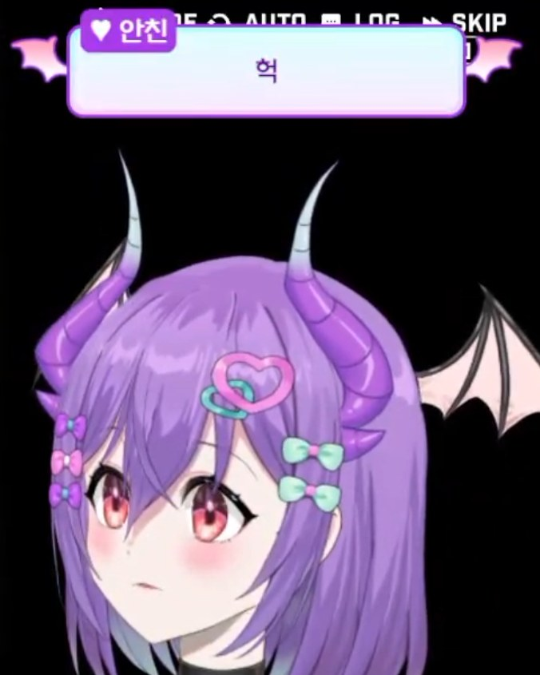

## 1막 · 문을 열며

Q. 처음 만나는 분들께 자기소개 부탁드려요. 방송에서 쓰는 인사말 그대로요!

"자! 오늘도 서큐버스의 침실이 문을 열었어! 모두 키세하, 리세하! 퍼블단들의 서큐버스, 키리사키 세이쨩이 여기 왔네! 모두 서큐버스의 침실에 어서 와! 오늘도 즐겁게 지내 보자!"

안녕하세요! 치지직에서 방송 중인 서큐버스 스트리머, 키리사키 세이라고 해요~! '세하'라는 인사는 다른 분들도 많이 쓰시다 보니까, 제 성인 키리사키의 첫 글자 '키'를 붙여서 '키세하'라고 인사하고 있어요. '키리'의 '리'를 따서 '리세하'라고 할 때도 있지만, 주로는 키세하예요!

Q. '키리사키 세이'라는 이름에는 어떤 이야기가 담겨 있나요?

성인 '키리사키'는 제가 버튜버로 데뷔하기 전에 쓰던 이름이에요. 원래 '키리사키 프로듀서'라는 닉네임으로 성우 정보를 다루는 유튜브 채널을 운영했었는데, 그때의 활동명을 그대로 성으로 가져왔어요.

'세이'는 목소리를 뜻하는 한자 '성(声)'을 일본어 음독으로 읽은 거예요. 오랫동안 성우와 목소리 이야기를 전해 왔으니까, 그 마음을 이름에 담고 싶었어요. 그렇게 키리사키와 세이를 합쳐서 '키리사키 세이'가 됐답니다.

Q. 방송을 찾아보니 '버미육' 스트리머시더라고요. '버미육'이 무엇인지 소개해 주세요.

버미육은 '버추얼 미소녀의 육체를 얻었다'는 뜻의 일본어 표현을 줄인 말이에요. 예전에는 여성 버추얼 아바타로 활동하는 스트리머를 남녀 구분 없이 통틀어 부르는 말이었어요.

그런데 언제부턴가 남성분들이 여성 아바타로 활동하는 경우가 많아지면서, 지금은 '버추얼 미소녀의 몸을 가진 남성'이라는 의미로 자리를 잡았어요. 저도 바로 그런 케이스고요(웃음).

---

*편집자 주* — HGE Creator 안에서도 키리사키 세이는 활발하게 활동하는 몇 안 되는 버미육 스트리머다. 남성 크리에이터가 미소녀 아바타로 자신만의 캐릭터를 연기하는 버미육은, 버추얼 방송 문화의 폭을 넓혀 온 흥미로운 장르이기도 하다.

Q. 방송을 처음 켠 날을 기억하나요?

다른 분들은 데뷔 RP 이벤트도 하고 준비를 많이 하시잖아요. 저는 정말 그런 것 없이 시작했어요. 지금이야 Live2D로 방송하고 있지만, 그때는 간단하게 만들 수 있는 3D 아바타 프로그램 하나로 바로 방송을 켰거든요. 지금은 목소리 세팅까지 신경 쓰지만, 당시에는 마이크 세팅만 딸랑 하고 시작했어요(웃음).

그러다 보니 미숙한 면이 정말 많았어요. 지켜보던 분들도 "아유, 제대로 준비 안 했네" 하면서 핀잔을 많이 주셨던 기억이 나요. 지금 생각하면 맨땅에 헤딩 그 자체였죠. 그래도 돌이켜 보면, 그런 기억들 덕분에 제가 뭘 잘못했는지 되돌아볼 수 있었으니까 그것도 좋은 시간이었구나 싶어요.

## 2막 · 세상 속으로

Q. 처음 오는 분께 "내 방송은 이런 곳"이라고 소개한다면요?

제 방송은 다른 분들에 비하면 짧다면 짧은 편이에요. 평일에는 딱 3시간 정도만 방송하거든요. 그래서 그 시간 안에 최대한 시청자분들을 즐겁게 만들고 싶어서 정말 열심히 하는, 그런 방송이라고 말씀드리고 싶어요.

대신 주말에는 그 두 배인 6시간 정도 방송해요. 주로 게임을 하면서 이런저런 이야기도 나누고, 게임 속 캐릭터 목소리를 들으며 "나라면 이 대사를 이렇게 연기하겠다" 하고 분석해 보기도 해요. 시청자분들과 함께 어울리며 교감하고, 다양한 걸 같이 체험해 볼 수 있는 방송이에요.

Q. 키리사키 세이 방송에서만 볼 수 있는 콘텐츠가 있다면요?

한동안은 저만의 콘텐츠라고 할 만한 게 없었어요. 그래서 다음 주부터 매주 금요일마다 정보를 나누는 고정 콘텐츠를 시작하려고 해요. 우리나라에서는 '파워레인저'로 잘 알려진 일본 특촬물, '슈퍼전대' 시리즈를 소개하는 방송이에요.

그리고 방송을 시작하기 전 성우 지망생이던 시절 이야기를 꺼내면서, 한국과 일본의 성우 이야기도 들려드릴 예정이에요. 게임이나 애니메이션 속 캐릭터 음성을 함께 들어 보면서, 버추얼 크리에이터에게 가장 기본이자 중요한 '목소리'에 대해 이야기하는 콘텐츠도 준비하고 있어요.

게임은 요즘 '승리의 여신: 니케'를 많이 하고 있고, 가끔 '배틀그라운드'나 '용과 같이' 시리즈 같은 액션 게임도 즐겨요.

Q. 캐릭터의 세계관과 설정(RP)을 소개해 주세요.

애니메이션을 보면 남자가 여자로 변하는 'TS'라는 장르가 있잖아요. 저도 얼추 그런 속성이 있어요(웃음).

앞서 제가 '키리사키'라는 이름으로 활동했었다고 말씀드렸죠? 서큐버스 세계에서 쫓겨난 서큐버스 '세이'가 바로 그 키리사키에게 빙의하면서, 여성의 몸이 되어 '키리사키 세이'가 됐다는 설정이에요.

문제는 인간계에서 살아남는 거였어요. 겉으로 보면 여자인데 속은 남자인 채로 살아가기란 너무 힘들겠다고 고민하던 중에, 같은 버미육 방송인을 보게 됐어요. 그때 '아, 인간계에서 살아남으려면 방송을 해야겠구나!' 하고 방송에 뛰어들게 됐다는 이야기랍니다.

> 겉은 미소녀, 속은 남자. 인간계에서 살아남으려면 방송을 해야겠구나 싶었어요.

Q. 시청자를 부르는 애칭이 있나요?

성우 정보 채널을 하던 시절에는 '녹음실 직원'처럼 부르기도 했는데요. 서큐버스로 확실히 자리를 잡으면서 '퍼블'이라는 이름이 붙었어요. 보랏빛 악마, 그러니까 퍼플(Purple)과 데빌(Devil)을 합쳐 줄인 말이에요.

FPS 게임을 많이 하시는 분들은 가끔 '퍼스트 블러드'를 떠올리시더라고요(웃음). 그런데 퍼블은 제가 배틀그라운드에 입문하기 전부터 쓰던 표현이에요. 악마들은 사역마를 데리고 다닌다고 하잖아요. 거기서 따온 이름이라, 실제로 퍼블 일러스트도 있어요.

시청자분들이 많으니까 프로필에는 단체를 뜻하는 '단'을 붙여서 '퍼블(단)'이라고 적고 있어요. 방송에서는 "우리 퍼블단~" 하고 부를 때도 있고, "퍼블이 왜 그래~" 하고 부를 때도 있어요.

Q. HGE Creator 콜라보로 플레이한 게임 중 기억에 남는 게임은요?

그중에서 꼽자면, 끝까지 클리어하진 못했지만 '빈 칸을 채워줘!'가 가장 기억에 남아요. 그림체도 아기자기하고, 주인공이 히로인과 함께 성장해 나가는 모습이 정말 인상적이었어요. 제가 원래 성장 스토리를 좋아하기도 하고, 연애 요소가 살짝 가미된 채로 인물들이 함께 성장한다는 게 신선하게 다가와서 정말 재미있게 했어요.

## 3막 · 다음 장으로

Q. 앞으로 시청자들에게 어떻게 기억되고 싶나요?

솔직히 고백하면(웃음), 아직 제 방송에 아쉬운 점이 많아요. 시청자분들도 이야기해 주셨던 것 중 하나가 제 대화술이 조금 부족하다는 거였거든요. 그래서 앞으로는 시청자분들과 더 많이 대화하고 떠들면서, 마음속에 있는 걸 마음껏 털어놓을 수 있는 안식처 같은 스트리머가 되고 싶어요.

물론 버미육이라는 점이 누군가에게는 벽이 될 수도 있겠죠. 하지만 그런 건 신경 쓰지 않으려고요. 그냥 '나만의 서큐버스' 같은 존재로, 방송 안에서 편하게 고민도 나누고 이런저런 이야기를 하면서 스트레스도 풀고, 다양한 것에 함께 공감하며 지내는 스트리머가 되고 싶어요.

> 버미육이 벽이 될 수도 있겠지만, 마음껏 털어놓을 수 있는 '나만의 서큐버스'가 되고 싶어요.

Q. 이 인터뷰를 읽고 있을 퍼블단에게 한마디 해주세요.

우리 퍼블단들, 내가 처음으로 인터뷰라는 걸 하게 됐어! 저번에 다들 나한테 이야기 많이 해 준 덕분에, 오랫동안 방송하면서도 잊고 있었고 몰랐던 것들을 많이 알게 됐어. 그런 것처럼 우리 앞으로도 계속 교감하고 이야기 많이 나누면서 행복하게 방송 이어 가자.

그리고 언젠가 세이가 보이스체인저를 떼고 여목(여성 발성)으로 방송하게 될 때도, 계속 응원해 줘야 한다? 사랑해, 퍼블단! 💜
