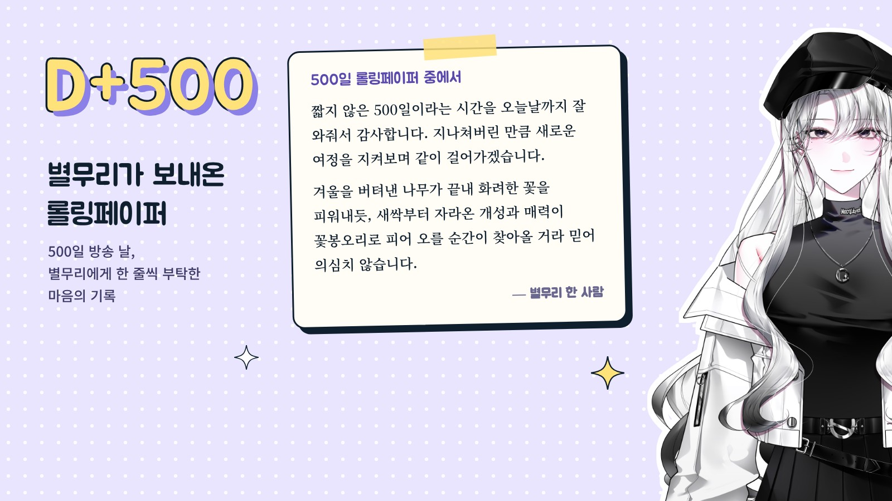

```plain
## 1막 · 문을 열며


Q. 처음 만나는 분들께 자기소개 부탁드려요.


안녕하세요, 치지직에서 방송하고 있는 문유별이에요. 크게 게임 방송과 노래 방송 두 가지를 하고 있고, 가끔은 별무리분들과 저챗도 준비해서 여러 모습의 저를 보여드리려고 하는 스트리머라고 생각해 주시면 좋겠어요.


Q. 요즘 메인 콘텐츠를 하나 꼽는다면요?


지금은 게임이에요. 예전에는 노래 방송을 많이 했는데, 방송을 길게 가져가다 보니 노래만으로는 다 채우기 어렵겠다는 생각이 들더라고요. 그래서 스트리트 파이터, 포켓몬, 림버스 세 가지를 주력으로 하고 있고, 요즘은 특히 스트리트 파이터랑 포켓몬을 제일 많이 해요.


Q. 스트리트 파이터는 여성 스트리머에게는 꽤 마니악한 게임으로 알려져 있는데요. 어떻게 시작하게 됐나요?


스파를 하시던 별무리분이 "유별님도 한번 해보실 생각 없으세요?" 하고 먼저 추천해 주셨어요. 어릴 때 오락실에서 격투 게임을 한 번씩 해봤던 추억이 떠올라서 가볍게 입문했는데, 생각보다 너무 잘 맞는 거예요. 상대와 심리전을 하면서 겨루는 그 재미가요.


그렇게 시작한 게 어느새 주캐 '마이'로 플래티넘까지 올라왔어요. 마스터는 어려울 것 같아서(웃음) 지금은 다이아를 목표로 열심히 달리고 있습니다.


Q. '문유별'이라는 활동명은 어떻게 지었나요?


원래 우주나 달 같은 걸 정말 좋아해요. 시청자분들께 오래 기억될 이름을 짓고 싶어서 고민을 많이 했고, 겹치는 닉네임이 없는지 검색도 여러 번 해봤어요. '문유성', '유별' 같은 후보도 있었는데, 달(Moon)과 별이 한 이름에 같이 들어가면 좋겠다 싶어서 '문유별'이 됐어요.


Q. 방송을 처음 켜던 날을 기억하나요?


사실 처음엔 방송을 할 생각이 없었어요. 노래를 좋아해서 버튜버로 유튜브에 커버곡을 조금씩 올리려고 했거든요. 그런데 한 별무리분이 커버 영상에 "며칠 뒤에 군대에 가는데, 그 전에 방송 한 번만 켜주시면 안 될까요?"라는 댓글을 남겨주셨어요. 꾸준히 영상을 봐주시고 커버까지 들어주시는 게 너무 고마워서, 그때 처음 방송을 켰어요.


PPT랑 대본까지 열심히 준비했는데도 엄청 떨렸어요. '과연 누가 와서 봐주실까' 불안하기도 했고요. 그런데 막상 켜니까 놀러 와주시는 분들이 계셔서, 떨리고 신기하고 고마운 감정이 한꺼번에 교차했던 게 기억나요.


## 2막 · 세상 속으로


Q. 처음 오는 분께 "내 방송은 이런 곳"이라고 한 문장으로 소개한다면요?


시크해 보이는 사람인 줄 알고 들어왔다가, "아, 동네 언니 같은 사람이구나" 하고 편해지는 방송이요. 그렇게 느껴주시면 제일 좋겠어요.


Q. 시청자 애칭 '별무리'에는 어떤 이야기가 담겨 있나요?


제 세계관이랑 이어져 있어요. 저는 달에서 온 요원인데, 지구에 내려와 사람들의 감정을 느끼고 그 감정을 별로 기록하는 일을 해요. 그래서 시청자분들 한 분 한 분이 제가 기록한 별이 되고, 그 별들이 모인 게 '별무리'예요.


처음엔 별이랑 어울리는 이름이라 별무리라고 지었는데, 세계관이 조금 늦게 생기면서 이걸 하나의 이야기로 이어가 보면 좋겠다 싶었어요. 그렇게 지금의 별무리가 됐어요.


> 시청자분들 한 분 한 분이 제가 기록한 별이에요. 그 별들이 모여서 별무리가 된 거죠.


Q. 별무리가 문유별을 놀릴 때 쓰는 밈이 있다면요?


제가 편한 사람이 되고 싶다고 했잖아요. 그래서인지 별무리분들이 저를 바보라고 놀릴 때가 있는데요(웃음), 제 이름 '유별' 사이에 '바보'를 끼워 넣어서 '유바별보'라고 불러요. 반대로 칭찬할 때는 '천재'를 끼워 넣어서 '유천별재'고요. 둘 다 제 이름으로 노는 저희 방송만의 밈이에요.


Q. 지금까지 방송하면서 가장 잊히지 않는 순간은요?


얼마 전 500일 방송이요. 별무리분들께 롤링페이퍼를 부탁드렸어요. 저는 늘 자주 오시는 분들과 이야기하듯 방송을 하다 보니, 생각보다 많은 분이 제 방송을 보고 있다는 걸 가끔 잊어버리거든요. 그런데 정말 많은 분이 응원 글을 써주셨어요. 길고 감동적으로 써주신 분도, 짧게 마음을 남겨주신 분도 계셨고요.


제 방송이 누군가에게 재미가 되고 응원이 되고 있구나 하는 게 글로 느껴져서 정말 뿌듯했어요. 그 순간이 제일 기억에 남아요.


Q. 그 롤링페이퍼 중에서 특히 마음에 남은 글이 있나요?


시처럼 써주신 분이 계셨어요. 이 글이 오래 기억에 남아요.


"짧지 않은 500일이라는 시간을 오늘날까지 잘 와줘서 감사합니다. 저는 비록 최근에 뵙게 됐기에 이미 지나온 과정을 알 수 없지만, 지나쳐버린 만큼 새로운 여정을 지켜보며 같이 걸어가겠습니다. 겨울을 버텨낸 나무가 끝내 화려한 꽃과 우거진 잎을 피워내듯, 새싹부터 자라온 개성과 매력이 꽃봉오리로 피어 오를 순간이 찾아올 거라 믿어 의심치 않습니다."





## 3막 · 다음 장으로


Q. HGE Creator의 '버츄얼 IN 홍대'에 참여해 첫 오프라인 전시를 해봤는데요. 어땠나요?


새로운 게임, 인디 게임을 소개할 수 있어서 너무 좋았어요. 저는 늘 하던 게임만 하다 보니 새로운 걸 도전해 보고 싶어도 뭘 골라야 할지 고민이 많았는데, 이번에 여러 장르를 보면서 '이런 장르도 있네, 저런 장르도 있네' 하고 새로운 게임을 많이 알게 됐어요.


행사 소개용 PPT도 직접 만들었는데, 개발자분들이 열심히 만든 게임을 내가 소개할 수 있다는 게 괜히 뿌듯하더라고요. 정말 좋은 경험이었어요.


---


*편집자 주* — 문유별이 직접 만든 게임 소개 PPT는 행사 관계자와 참여 게임사에도 전달됐다. 방송에서 모든 게임을 다 플레이할 수는 없었지만, 한 게임 한 게임을 정성껏 소개한 이 자료 덕분에 어떤 게임도 그냥 지나쳐지지 않았다는 걸 보여줄 수 있었다.


Q. 언젠가 꼭 해보고 싶은 꿈의 방송이 있다면요?


노래로 처음 시작해서 그런지 음악 자체를 정말 좋아해요. 기회가 된다면 노래 잘하는 별무리분들이든 스트리머분들이든, 싱크룸에서 세션과 함께 밴드처럼 합주하는 콘텐츠를 꼭 해보고 싶어요.


---


문유별의 시작이었던 노래가 궁금하다면, 대표 커버 영상부터 들어보세요.


https://www.youtube.com/watch?v=sZUtCaAP9v4


Q. 이 인터뷰를 읽고 처음 방송에 들어올 별무리에게 한마디 해주세요.


"새로운 별무리는 언제나 환영이야!" 새로 와주시는 분들께 늘 하는 말이에요. 기분이 안 좋은 날도, 좋은 날도, 그냥 평범한 날도 괜찮으니까 언제든 편하게 놀러 와주세요. 저는 어디 가지 않고 늘 여기 있을게요. 좋은 친구로, 동료로, 그리고 별무리와 스트리머로 오래오래 함께해요.


> 저는 어디 가지 않고, 늘 여기 있을게요.
```
