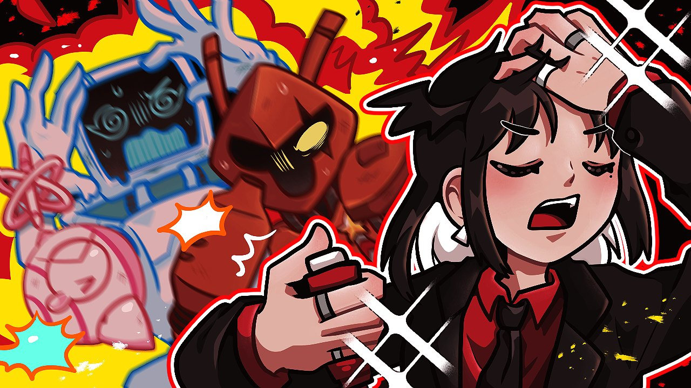
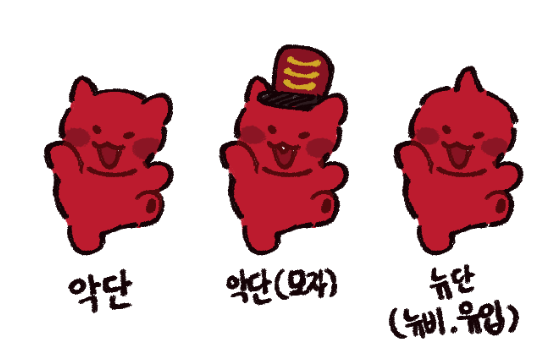

## 1막 · 문을 열며

Q. 처음 만나는 분들께 자기소개 부탁드려요.

능하! 안녕하세요, 여러분들. 벤비뉴~ 누아르 타운 출신 악마 보스 나능요입니다!

저는 본업이 그림을 그리는 사람이기도 해서 방송에서 작업 방송(작업뱅)을 할 때도 있고, 섬네일이나 배너, 이모티콘 같은 작업물들은 지금까지 쭉 제가 직접 만들어 왔다고 보시면 됩니다!

그림 외에는 제 외형이나 취향에 맞는 게임들을 하고 있어요. 방송 일수나 시간은 다른 분들보다 짧다고 느끼실 수 있지만, 방송을 켤 때면 늘 텐션이 높아서 오디오가 빌 날이 없는, 그런 짧고 굵은 방송이에요.

Q. '나능요'라는 이름은 어떻게 만들게 되었나요?

사실 큰 뜻이 있는 건 아니에요. 지금 만들어서 몇 년 뒤에도… 몇십 년 뒤에도 사용했을 때 무난하고 괜찮은 나의 이름이 없을까 고민하다가 정하게 되었답니다!

여러분도 아시다시피 원래는 "나는요~"라는 뉘앙스인데, '는'의 받침 니은(ㄴ)을 이응(ㅇ)으로 바꿔서 좀 더 귀엽고 친근한 느낌이 나도록 만들었어요.

3음절이라 외우기도 간단하고, 남들이 쓰는 이름도 아니라서 이걸로 결정하게 됐네요!

Q. 캐릭터의 세계관과 설정(RP)을 소개해 주세요.

저는 무채색과 빨간색만 공존하던 누아르 타운에서, 여러 종족과 화려한 색이 존재한다는 지구에 관심을 갖게 됐어요. 그게 사실인지 확인하려고 첫 출장을 온 이후로, 악단들과 함께 인간 세계의 문화와 생물을 보면서 이곳저곳을 탐험하고 기록하며 살아왔는데요. 그런 하루하루가 반복되다 보니 지구라는 곳이 제 고향과는 다른 매력이 있어서 참 좋더라고요. 지구에 온 뒤로 꽤 많은 시간이 지나서, 지금은 이 생활에 익숙해진 상태랍니다.

저는 오래전부터 직장 생활에 익숙하고, 일 중독자라 "바쁘다"는 말을 참 많이 하는 편인데요. 고향을 다스리는 보스라는 직책에 딱 맞는 평소 발언이라고 생각해요.

Q. 방송을 처음 켜던 날을 기억하나요?

네, 기억해요. 원래는 방송을 해 보자는 생각을 한 번도 안 해 봤어요. 그런데 주변 사람들이 "말재주도 좋고 말수도 많으니 뭐든 잘하겠다", "방송에도 특화돼 있지 않냐"는 말을 참 많이 했었어요.

그때까지만 해도 얼굴도 마주 볼 수 없는 남 앞에서 무언가를 말한다는 것 자체가 익숙하지 않고 어색해서, 안 하겠다고 단정 지었는데요.

그러다 어느 날, 늘 하던 일상적인 일이나 취미가 유독 시들시들해서 심심하던 차에 주변 사람들이 방송을 해 보라던 말이 문득 떠올랐어요. 그날 바로 벌떡 일어나서 딱 한 달이라는 기간을 정해 두고, 제 모습과 콘셉트, 방송 세팅법 같은 걸 찾아보면서 발 빠르게 준비했답니다.

데뷔 홍보도 없이 '행동이 먼저다!'라고 생각해서, 대략적인 준비만 끝낸 뒤 바로 방송을 켰어요. 정말 초창기라 주변 지인들을 방송에 초대해서 이야기 나누며 긴장을 풀었던 기억이 나요(웃음).

처음엔 트위치에서 방송을 시작했는데, 방송에 발을 들인 지 얼마 되지 않아 한국 트위치 서버가 종료되는 웃긴 일도 있었네요. 지금은 치지직에서 활동하고 있어요!

> '행동이 먼저다!'라고 생각해서, 대략적인 준비를 끝낸 뒤 바로 방송을 켰어요.

## 2막 · 세상 속으로

Q. 처음 오는 분께 "내 방송은 이런 곳"이라고 소개한다면요?

누아르 출신답게, 그리고 생긴 모습처럼 정말 빨갛고 어둑어둑한 색으로 이루어져 있어요. 오죽하면 여동생이 제 유튜브를 보고 "언니 유튜브는 왜 이렇게 빨개?"라고 한 적도 있어요(웃음).

하지만 마계의 악마라는 종족의 외형과는 다르게, 제 성격은 의외로 털털하고 말이 정말 많답니다. 적막이 늘 심심하게 느껴져서, 자꾸 여러분께 말을 걸고 겪었던 일들을 늘어놓으며 정말 수다스럽게 굴어요. 어찌 보면 외형과 성격이 반대인 느낌이죠!

성향으로 보면 보스답게 존댓말만 사용하는 방송이에요. 그리고 J답게 계획적이고 원칙을 중요시하는데… 인정하기 싫지만, 악단들과 지내면서 P의 성향도 조금씩 받아들이게 됐어요(웃음). 가식 없는 솔직한 방송이면서, 규율을 중요시하는 방송이라고 생각하면 좋겠네요.

평소에는 제 종족과 어울리는 다크 어드벤처나 미스터리 장르의 게임을 하고, 본업인 일러스트 작업 방송을 켜고 시청자인 악단들과 소통하며 지내고 있습니다~!

Q. 시청자를 부르는 애칭이 있나요? 어떤 모습인가요?

네! 저는 시청자들을 '악단'이라고 불러요. 악단은 '악마 군단'이라는 뜻이기도 하고, 기악이나 성악을 연주하는 그룹을 뜻하기도 하죠!

그래서 저희 시청자들은 신이 날 때 북을 두드린답니다. 베테랑 악단은 그에 걸맞은 계급 모자를 쓰고 있기도 하고, 저를 너무 좋아하고 따르는 나머지 눈이 초롱초롱한 모습이기도 해요.

제 대표색답게 붉은 몸을 가졌고, 귀여운 콩알눈에 뾰족한 송곳니가 앞니에 하나 달려 있어요. 뾰족한 꼬리도 하나 있고요. 악단의 외형과 애칭은 모두 제가 직접 생각하고 구상한 건데, 이름도 마음에 들고 외형도 전체적으로 동글동글하고 통통해서 늘 정말 귀엽다고 생각하고 있어요!

Q. 나능요 방송에서만 볼 수 있는 콘텐츠가 있다면요?

일러스트 작업이 본업이다 보니, 작업할 때면 늘 재미있었던 일화를 나누는데요. 말로만 설명하기 어려울 땐 타블렛 펜으로 실시간으로 그림을 그려 가며 표현하고, 돌발 상황이 생겨도 새 창을 띄워 빠르게 그려서 악단들과 재미있는 순간을 만들어 낸답니다. 제가 손이 정말 빠른 편이라, 몇 초만 주어져도 금방 뭔가를 그려 낼 수 있거든요!

그리고 한국에 계신 분들께는 조금 낯설 수도 있지만, 닌텐도 스위치의 '스플래툰 3'를 하고 있어요. 시작한 지 오래되지는 않았는데, 이 게임만 11월 기준으로 1,600시간 정도 했네요(웃음).

게임 실력이 높지는 않지만, 플레이할 때마다 클립이나 쇼츠각이 나오는 유쾌 통쾌한 순간이 정말 많아요. 공포 게임을 할 때도 비명을 잘 안 지르는 편인데, 이 게임만 하면 비명을 너무 잘 질러서 악단들이 스플래툰을 할 때마다 "또 공포 게임 한다"며 우스갯소리를 하기도 해요.

https://youtu.be/ldLniKYSAgo

Q. 지금까지 방송하면서 가장 기억에 남는 해프닝은요?

총 두 가지가 있어요. 지금은 흑역사나 마찬가지라 생각할 때마다 너무 부끄러운데요.

첫 번째는 마이크 세팅을 제대로 받지 못해서 제가 임의로 직접 세팅했던 적이 있었어요. 그런데 일정 시간이 지날 때마다 마이크에서 태풍 부는 소리가 나서 자꾸 시청자들의 고막을 터뜨린 거 있죠!! 그때 '프로젝트 좀보이드'를 하던 중이라 새로 유입된 분들이 많았는데, 마이크 상태 때문에 많은 새 시청자들을 떠나보냈던 슬픈 기억이 있어요.

두 번째는 '인스크립션'이라는 게임을 하고 있을 때였어요. 게임을 잘 하다가 갑자기 어디선가 수상한 냄새가 나는 거예요. 그래서 원인을 찾아봤더니… 세상에! 제 본체에서 고구마 굽는 냄새가 나는 거예요! 그 당시 방송 환경이 썩 좋지 않아서 본체 성능도 스트리밍용으로는 적합하지 않았거든요. 그때는 꽤 심각하게 걱정했어요. 다행히 방송은 정상적으로 진행했고 그 뒤로도 별 문제는 없었지만, 너무 놀라고 웃겼던 해프닝이라 이걸 주제로 영상도 만들어서 올린 적이 있답니다.

https://youtu.be/fsq12aLmDlM

지금은 그때보다 방송 환경도 많이 나아졌어요. 새 본체도 장만하고, 마이크 세팅도 전문가님께 받아서 이제 그런 문제는 없답니다~

Q. HGE Creator 콜라보로 플레이한 게임 중 기억에 남는 게임은요?

'전국퇴마사협회'를 콜라보로 플레이한 적이 있는데, 이 게임이 가장 기억에 남고 좋았어요!

분위기가 제 종족과 콘셉트에 잘 어울리는 데다, 한국의 귀신과 퇴마를 주제로 한 게임인데 인게임 아트워크나 완성도도 정말 높아 보였거든요. 처음 신청할 때도 아트워크가 너무 예뻐서 꼭 해 보고 싶었는데, 실제로 해 보니 그래픽이 정말 취향이었고 게임으로도 재밌었답니다. (몇몇 퍼즐은 어려웠지만요.)

콜라보 때는 0챕터만 진행하고 영상을 제출했는데, 이 인디 게임이 챕터를 계속 업데이트하고 있어서 업데이트될 때마다 시간 날 때 쭉 플레이했어요. 지금은 스트리밍이 불가능한 마지막 챕터를 빼고는 모두 방송에서 직접 플레이하면서 악단들과 감상을 나눴던 기억이 나요.

## 3막 · 다음 장으로

Q. 앞으로 시청자들에게 어떻게 기억되고 싶나요?

"이런 털털~하고 솔직한 사람도 있구나!"라는 걸 느끼게 해 주고 싶어요. 그리고 검정과 빨강, 악마 종족만 보면 제가 바로 생각나도록 악단들 기억 속에 영원히 각인되고 싶답니다.

제 취향이 정말 소나무나 마찬가지라, 가끔 닌텐도 다이렉트 같은 걸 시청자들과 함께 보다가 외형이 취향인 캐릭터가 나오면 너무 좋다고 반응하거든요. 몇몇 악단들은 캐릭터 외형만 봐도 "이거 보스 취향 아니에요?" 하고 찔러볼 정도예요(웃음).

그렇게 다른 게임이나 만화 캐릭터를 봤을 때 "아, 이거 보스 취향이겠다!" 하고 바로 떠올릴 수 있는, 그런 사람이고 싶네요.

> 검정과 빨강, 악마 종족만 보면 제가 바로 생각나도록 악단들 기억 속에 영원히 각인되고 싶어요.

Q. 언젠가 꼭 해 보고 싶은 꿈의 방송이 있다면요?

리액션이 정말 크고 많은 편인데, 2D 모델로만 활동하고 있어서 늘 아쉬워요! 여유가 된다면 3D 모델로 등장해서, 제가 평소에 어떤 모습으로 게임을 하고 그림을 그리는지, 어떤 실시간 반응을 하는지 시청자들에게 솔직하게 다 보여 주고 싶어서 몸이 근질거린답니다.

노래 방송은 지금까지 딱 세 번밖에 안 해 본 것 같은데, 좋은 기회가 생기면 저만의 자작곡을 만들어서 올려 보고 싶어요. 악단들에게도 뿌듯하게 자랑하고, 저를 처음 보는 시청자들에게도 홍보할 수 있는 만족스러운 곡으로요! 노래를 전문적으로 배워 본 적도 없고 지금은 치아 교정 중이라 막상 진행하면 어색하겠지만, 적어도 폐활량은 좋다고 생각해서 이게 노래 부를 때 강점이 되지 않을까 싶어요.

Q. 이 인터뷰를 읽고 있을 악단들에게 한마디 해주세요.

안녕, 악단들! 길고 긴 인터뷰 글 읽느라 수고했어~ 나를 생각해서 질문과 답변 하나하나 꼼꼼히 읽은 악단이 있다면? 칭찬 스티커 100개 찍어 줄게, 정말 고마워!

오늘 이렇게 좋은 기회가 생겨서 HGE Creator 인터뷰를 진행했는데, 이 글로 내가 몰랐던 모습이나 해프닝을 알게 된 악단들도 있겠어~ 앞으로도 좋은 기회가 있다면 적극적으로 참여해서 흥미로운 소식으로 찾아올게!

나능요 데뷔일 4월 18일! 나능요 생일 8월 18일! 꼭 기억하길~!! LOVE YOU ALL 😍💕💕
