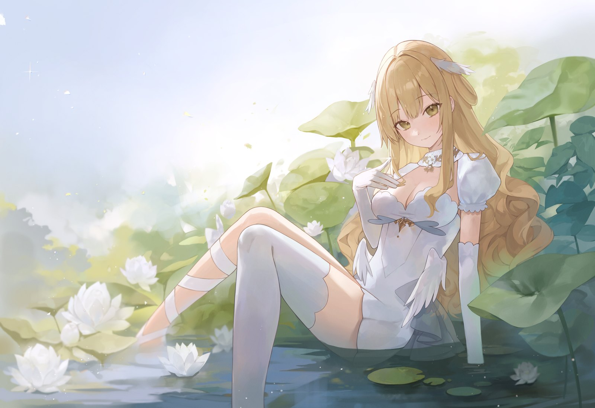

## 1막 · 문을 열며

Q. 처음 만나는 분들께 자기소개 부탁드려요.

안녕하세요, 치지직에서 종합 게임 위주로 방송하고 있는 오데트라고 합니다. 
방송을 시작하고 게임을 접했기 때문에 유명한 게임도 잘 모르는 때가 많지만, 어떤 컨텐츠든 가리지 않고 열심히 하고 있어요!

Q. '오데트'라는 활동명은 어떻게 짓게 됐나요?

활동명을 정하게 된건 이미지를 정하고 나서에요.
평소 방송하는 분위기와 어울리는 단정한 외형을 원했지만, 너무 단순하기만 하진 않았으면 하는 마음에 특별한 표정을 가지고 싶었어요.

그러다 일러스트레이터님의 의상 바리에이션에서 발레복을 확인 후 이거다! 싶은 마음이 들었어요.
보통 '오데트'하면 백조를 떠올리잖아요. 그런데 "차라리 오데트가 오리라면 어떨까?" 하는 생각이 들어서 오리인 오데트가 됐어요.

귀여운 오리 표정을 트레이드 마크로 가지고 있어요(웃음)

Q. 방송을 처음 켜던 날을 기억하나요?

저는 거창한 각오보다는 "방송 한 번 해볼까?" 하는 가벼운 마음으로 시작했어요. 작업자분들께 맡긴 작업이 생각보다 정말 빠르게 진행됐거든요. 일러스트가 나오자마자 바로 리깅에 들어가고, 데뷔 포스터까지 금방 완성되니까 "포스터 나왔네? 그럼 이번 주에 데뷔할게요!" 하고 바로 시작해 버렸어요.

준비한 콘텐츠도 따로 없이 조금 엉성하게 시작해서, 설렘이나 긴장보다는 "새로운 도전이다, 재밌겠다!" 하는 마음이 더 컸던 것 같아요(웃음).

## 2막 · 세상 속으로

Q. 처음 오는 분께 "내 방송은 이런 곳"이라고 소개한다면요?

메인 콘텐츠를 딱 정해두지는 않았어요. 인디 게임을 위주로 폭넓게 방송하고 있고, 그중에서도 로그라이크 장르를 정말 좋아해요. 한 게임만 계속하기보다는, 올 때마다 늘 새로운 게임을 맛볼 수 있는 곳. 그게 제 방송의 장점이라고 생각해요.

Q. 캐릭터의 세계관과 설정(RP)을 소개해 주세요.

저는 원래 백조의 호수에서 백조들과 함께 자랐어요. 저도 당연히 백조인 줄 알고 컸는데, 알고 보니 오리였던 거예요. "어? 그럼 여기에는 있을 수가 없겠구나" 싶어서 호수 밖으로 독립했고, 그게 제 방송의 첫 시작이에요. 그래서 이 방송이 저에게는 독립의 첫걸음인 셈이에요.

> 알고 보니 제가 오리였던 거예요. 그래서 호수 밖으로 독립했고, 그게 제 방송의 첫 시작이에요.

Q. 시청자를 부르는 애칭이 있나요?

'리쭈단'이에요! 이것도 세계관이랑 이어져 있어요. 저는 호수를 나와서 오리 농장을 따로 만들었는데, 저희 팬카페 이름이 바로 '오리 농장'이에요. 그 농장에서 제 독립을 함께해 주시는 분들을 '오리 주민'이라고 부르고, 거기서 '리주'를 따서 리쭈단이 됐어요.

Q. 지금까지 방송하면서 가장 잊히지 않는 장면은요?

제가 사람을 공격하거나 총을 쏘는 게임을 하게 될 거라고는 전혀 생각을 못 했어요. 그런데 아는 스트리머분이 배틀그라운드 대회를 여신다고 하셨고, 초심자도 괜찮다고 하셔서 "그럼 나도 해볼까?" 하고 신청했어요.

막상 대회에 붙고 나니 실력이 너무 부족해서 팀에 짐이 되진 않을까 걱정이 많았어요. 그런데 멘토로 함께해 주신 분이 배그를 정말 잘하시는 분이셨고, 주변 스트리머분들께 많이 배우고 연습한 끝에 꽤 좋은 성적을 거둘 수 있었어요.

평소 하던 게임이 아니어도, 과격하지 않은 저만의 방식으로도 색다른 모습을 보여줄 수 있구나. 그때 생각이 확 바뀌었어요. 그 뒤로는 슈팅 게임이든 PVP가 있는 게임이든 가리지 않고, 재밌어 보이면 다 도전할 수 있게 됐어요. 자신감을 얻은 계기였던 것 같아요.

Q. HGE Creator 콜라보로 플레이한 게임 중 기억에 남는 게임은요?

게임 자체는 전부 제 취향이었는데, 그중에서도 꼽자면 'Quiet'가 가장 좋았어요. 일단 주인공이 저랑 딱 맞는 '오리'라는 점이 너무 좋았고요(웃음). 캐릭터가 오리다 보니 제 개성을 더 살릴 수 있겠다 싶었는데, 실제로도 재밌는 장면이 정말 많이 나와서 즐겁게 플레이했어요.

## 3막 · 다음 장으로

Q. 앞으로 이 방송이 시청자들에게 어떤 곳이 되었으면 좋겠나요?

저는 아직 이렇다 할 특색이 있는 방송은 아니라고 생각해요. 그 대신 조금 평범할 수는 있어도, 질리지는 않는 방송이 됐으면 좋겠어요. "아, 또 이거 하겠네"보다는 "오늘은 뭘 할까?" 하고 기대하게 되는 방송이요.

언제든 편하게 들어와 있다가, "오늘도 재밌었다" 하고 편하게 나갈 수 있는 그런 방송이었으면 좋겠어요.

> 평범할 수는 있어도, 질리지 않는 방송이 되고 싶어요.

---

*편집자 주* — 오데트는 HGE Creator의 서포터 앰배서더로도 활동하며, 특유의 끼와 재능으로 커뮤니티를 함께 꾸려가고 있다.

Q. 이 인터뷰를 읽고 처음 방송에 들어올 분들께 한마디 해주세요.

시작부터 지금까지 계획적이지는 못했던 방송인 것 같은데, 그런데도 2년 넘게 저를 응원해 주셔서 정말 감사해요. 앞으로도 특출나게 재미있는 방송을 약속드릴 수는 없지만, 지금처럼 조금 삼삼하더라도 계속 보고 싶은 방송을 이어나갈게요.

새로 오신 분들도, 늘 함께해 주신 리쭈단도 끝까지 응원해 주시면 감사하겠습니다!!
