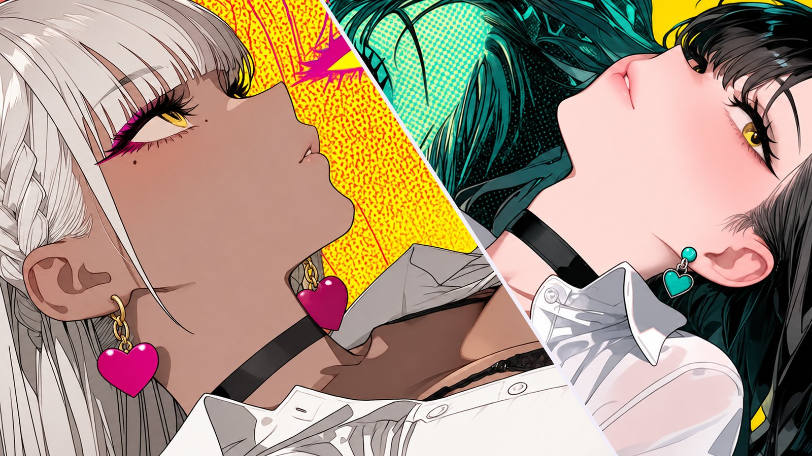

## 1막 · 문을 열며

Q. 처음 만나는 분들께 자기소개 부탁드려요. 방송에서 쓰는 인사말이 있다면 그대로 들려주세요.

인사말이라기보다 처음 오신 분들께 꼭 드리는 말이 있는데요. "안녕하세요, 린세 컴퍼니에 입사하신 걸 환영합니다!"

'입사'라고 하는 건, 제 방송이 '린세 컴퍼니'라고 불리고 있어서예요. 시청자분들도 저를 '사장님'이라고 불러 주세요. 특별한 이유가 있는 건 아니고, 예전에 시청자분들이 사장님이라고 불러 주시던 게 지금까지 그대로 이어지고 있어요.

저는 치지직에서 방송하고 있는, 게임에 진심인 종합 게임 스트리머 린세 이데입니다. 장르 가리지 않고 다양한 게임을 즐기는 잡식러예요. 게임을 좋아하신다면 저희 회사에도 출근해 주시면 감사하겠습니다. 잘 부탁드려요!

Q. '린세 이데'라는 활동명은 어떻게 짓게 됐나요?

'린세 이데'를 하나로 이어서 생각해 주시는 분들이 많은데요. 사실은 '린세'와 '이데', 두 이름을 합친 활동명이에요. 두 이름 모두 '친구'라는 이름의 작명소에서 받아 왔어요. 그러니까 친구가 지어 준 이름들이죠(웃음).

린세도 저고, 이데도 저예요. 어느 한쪽만 제 이름이 아니라, 둘 다 제 이름 그 자체라고 생각해 주시면 돼요.

Q. 방송을 처음 켠 날을 기억하나요?

정말 아무 생각 없이 켜서 오히려 더 기억에 남는 첫날이었어요. 트위치 시절이었는데, 그때 제가 뒤늦게 몬스터 헌터에 빠져서 한창 플레이하던 중이었거든요. 친구들이랑 같이 하고 있는데 한 친구가 "네 플레이 볼 수 있게 방송 좀 켜 줘"라고 했어요.

저는 그 친구 한 명한테 보여 주는 1:1 방송 정도로 생각하고 그냥 켰어요. 게임을 워낙 좋아하다 보니 방송을 할 수 있는 장비는 이미 다 갖춰져 있었거든요. 방송을 위해 마련한 건 아니었지만요.

친구에게 보여 주려고 켠 방송이라 정말 아무것도 없었어요. 짚톡도, 그림도, 제 모습도 없었죠. 그런데 그런 방송에 사람들이 찾아와 주셨어요. 처음 보는 분들이 제 게임을 보면서 같이 이야기를 나눠 주고, 도와주기도 하고요. 그게 너무 신기하고 재밌더라고요. 그게 시작이었고, 어느새 3년이 다 되어 가네요.

> 아무것도 없는 방송에 처음 보는 분들이 찾아와 주셨어요. 그게 시작이었고, 어느새 3년이 다 되어 가네요.

## 2막 · 세상 속으로

Q. 처음 오는 분께 "내 방송은 이런 곳"이라고 소개한다면요?

정말 누구나 와서 편하게 머물다 갈 수 있는 방송이라고 생각해요. 특히 게임을 좋아하신다면 더 잘 맞으실 거예요. 제가 좋아하는 게임, 시청자분들이 해 보고 싶었던 게임을 진짜 진심으로 즐기는 곳이거든요. 그래서인지 게임 좋아하시는 분들이 많이 모이는 편이에요.

자주 와 주시는 분들은 물론이고, 가끔 들러 주시는 분들도 게임이라는 공통점이 있으니까 이야기를 나누다 보면 자연스럽게 기억하게 돼요. 한 번 찾아와 주시는 것도 정말 소중한 인연이라고 생각하거든요.

친구가 게임하는 걸 옆에서 구경하다가 편하게 한마디씩 던지는, 그런 느낌의 방송이에요. 저의 털털함과 친근함이 방송의 가장 큰 특징이자 장점인 것 같아요.

https://www.youtube.com/watch?v=b3pTGOBEkhw

Q. 린세 이데 방송에서만 볼 수 있는 콘텐츠가 있다면요?

제일 많이 하는 건, 게임 하나를 열심히 파서 엔딩까지 본 다음에 크레딧이 올라갈 때 이야기를 나누는 거예요. 게임을 하면서 느낀 점, 제가 분석한 것들을 시청자분들과 정말 깊게 이야기해요. 시청자분들도 그 시간을 굉장히 좋아해 주세요.

그리고 좀 웃긴 건, 예전에는 게임을 하면서 노래를 종종 불렀어요. 몬스터 헌터로 사냥하면서 노래 부르기 같은 이상한 짓을 자주 했었죠(웃음). '용과 같이' 같은 스토리 게임을 할 때는 스토리를 다 같이 보는 시간도 많이 가져요. 정말 게임과 관련된 콘텐츠를 많이 하는 편이에요.

---

*편집자 주* — 린세 이데는 HGE Creator가 진행한 '버츄얼 in 홍대'에 라이브 스트리머로 참가해, 현장에서 즉흥 노래를 불러 큰 호응을 이끌었다. 행사 마지막 날, 정리가 한창이던 현장에 은은하게 퍼진 노래는 마치 행사의 엔딩 크레딧 같았다.

Q. 캐릭터의 세계관과 설정(RP)을 소개해 주세요.

저는 린세와 이데가 한 몸을 쓰고 있는 듀얼 페르소나 스트리머예요. 에너지가 넘치는 린세와 조용하고 잔잔한 이데가 서로 균형을 맞추며 살아가고 있어요.

보통은 린세가 텐션을 올려서 신나게 방송을 해요. 그러다 린세가 에너지를 다 써서 지치거나 힐링이 필요할 때는 이데가 대신 방송을 진행하죠. 두 사람은 좋아하는 게임 장르도 다르고, 방송 스타일도 달라요. 그래서 보시면 굉장히 색다른 맛이 있을 거예요.

저희는 인간인데 수인의 피가 조금 섞인 쿼터 수인이에요. 린세는 여우, 이데는 고양이라서 각각 귀와 꼬리가 있어요. 하지만 인간 사회에 섞여 지내야 하니까, 평소에는 주로 인간의 모습으로 생활하고 있답니다.

Q. 시청자를 부르는 애칭이 있나요?

시청자분들을 '뜸부기'라고 불러요. 제가 몬스터 헌터 방송으로 시작했는데, 한때는 하루 종일 24시간 방송을 할 정도로 오래 해서 '몬스터 헌터 스트리머'라고 불리던 때가 있었어요.

그 게임에 '폭신폭신 뜸부기'라는, 하얗고 동글동글한 정말 귀여운 새 친구가 있거든요. 거기서 이름을 가져왔어요. 다만 저희 뜸부기들은 린세 컴퍼니로 출근하는 '출근 뜸부기'라는 점이 조금 다르답니다(웃음).

Q. 지금까지 방송하면서 가장 기억에 남는 해프닝은요?

정말 많은데, 하나 꼽아 보자면요. 이사 오기 전에 살던 집이 정말, 정말 추웠어요. 이 시대에 기름보일러를 쓰는 집이라 겨울에도 보일러를 마음껏 틀 수가 없었거든요. 집 안 온도가 바깥이랑 비슷하게 1~2도까지 내려갈 정도였어요.

그 추위를 견디려고 리듬 게임을 했어요(웃음). 리듬 게임을 하면 손을 계속 움직이니까 손이 따뜻해지는 기분이 들거든요. 방송에서 "나 너무 추워서 리듬 게임 해야겠다" 하고 리듬 게임을 켜면, 뜸부기들은 "추워서 리듬 게임 하는 사람이 어디 있냐"며 슬퍼하고(웃음). 저는 살고자 리듬 게임을 하던 그 겨울이 계속 기억에 남아요.

Q. HGE Creator 콜라보로 플레이한 게임 중 기억에 남는 게임은요?

정말 많은 게임을 진행해서 고르기가 정말 힘든데요. 개인적으로는 '위니언 바이러스'와 '페블 나이츠'가 기억에 남아요.

위니언 바이러스는 사실 게임이 처음 나왔을 때 이미 플레이했던 게임이에요. 그래서 이번 콜라보 때는 그때의 플레이 영상을 시청자분들과 몇 시간 동안 같이 보는 시간을 가졌어요. 그런데 영상 속 제가 지금이랑 똑같은 부분에서 놀라고, 똑같은 부분에서 충격을 받는 거예요. 그 모습이 저도 웃기더라고요. 그 게임을 하면서 감정의 변화가 정말 컸어요. '이런 게임은 플레이할 때 조심해야겠다' 싶을 만큼 멘탈 데미지도 많이 받았고요. 그만큼 사람에게 영향을 줄 수 있을 정도로 깊은 스토리라고 생각해서, 정말 좋아하는 게임이에요.

페블 나이츠는요, 사실 제가 협동 게임을 그렇게 즐기는 편은 아니에요. 혼자 하는 걸 더 좋아하거든요. 그런데도 페블 나이츠는 정말 재밌었어요. 요즘 나오는 협동 게임들은 조금 밋밋한 느낌이 많았는데, 페블 나이츠는 변수도 많고 완성도가 굉장히 높았어요. 협동 게임으로서 이 정도로 재밌다고 느낀 게 정말 오랜만이었고, 시청자분들과도 많이 같이 했던 게임이라 기억에 남아요.

## 3막 · 다음 장으로

Q. 앞으로 시청자들에게 어떻게 기억되고 싶나요?

일단 게임에 정말 진심인 사람, 그리고 언제 찾아가도 편하고 재밌는 사람으로 기억되고 싶어요.

저는 좋아하는 게임을 소개하는 것도 좋지만, 반대로 뜸부기들이 뭘 좋아하고 어떤 게임을 좋아하는지 듣는 것도 정말 좋아하거든요. 그렇게 취향을 같이 나누면서 오래오래 함께 지내는 사람이고 싶어요.

잠깐 떠났다가도 언제든 뒤돌아봤을 때 그 자리에 있는 스트리머, 갑자기 찾아와도 어색하지 않은 사람이 되고 싶어요. 오랜만에 왔는데도 '여긴 여전히 편안해'라고 느낄 수 있는 방송이요. 그리고 내가 원래 좋아하던 게 아니어도, 같이 나눠 보니까 참 좋다고 느낄 수 있는 방송이었으면 좋겠어요.

> 오랜만에 왔는데도 '여긴 여전히 편안해'라고 느낄 수 있는 방송이었으면 좋겠어요.

Q. 언젠가 꼭 해 보고 싶은 방송이나 콘텐츠가 있다면요?

이건 정말 생각이 많은데요(웃음). 워낙 다양한 방송을 하다 보니 장르별로 하고 싶은 게 정말 많아요. 그래도 게임으로 생각해 보면, 제가 좋아하는 게임들의 홍보를 직접 진행해 보고 싶어요. 몬스터 헌터나 용과 같이 같은 게임들이요.

좋아하는 게임과 콜라보로 이어지는 것, 그게 제 가장 큰 꿈인 것 같아요.

Q. 이 인터뷰를 읽고 있을 뜸부기들에게 한마디 해주세요.

이렇게 인터뷰로 보니까 기분이 새롭네요. 자주 오는 뜸부기들, 가끔 생각나서 들러 주는 뜸부기들, 항상 정말 고맙고 소중해요.

제가 늘 하는 말이지만, 여기까지 방송할 수 있었던 건 여러분이 와 주셨기 때문이에요. 앞으로도 함께해 주고, 제가 좋아하는 것도 여러분이 좋아하는 것도 지금보다 더 많이 나눌 수 있었으면 좋겠어요. 항상 함께할 수 있도록, 더 열심히 하겠습니다!
