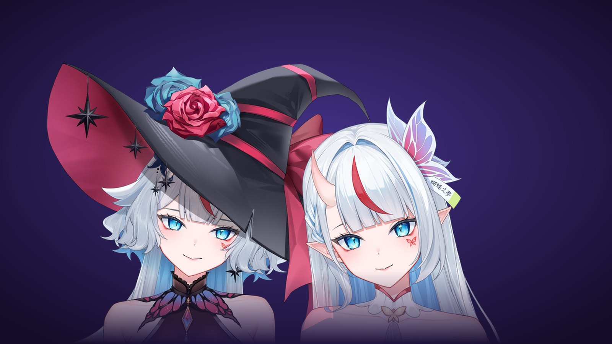

## 1막 · 문을 열며

Q. 처음 만나는 분들께 자기소개 부탁드려요.

안녕하세요, 저는 환각의 마녀 루멘시입니다!

주로 게임 방송을 하고 있고요, 요즘은 TRPG와 ASMR, 역할극 쪽 방송을 준비하고 있어요. 뿌리는 라이브 방송에 두고 있지만, 방송 밖에서는 오리지널 곡, 커버 곡, 보이스 드라마, 일러스트 같은 것들을 직접 기획해서 만들고 있어요. 올해는 비주얼 노벨도 제작하고 있답니다!

한마디로 하자면, 여러분의 마나를 착취하는 아주 못된 마녀입니다. 마나는… 생명력이라고 생각해 주시면 돼요(웃음).

Q. '루멘시'라는 이름은 어떻게 짓게 됐나요?

오늘은 루멘시 안에 있는 사람으로서 말씀드리자면, 저는 어릴 때부터 꿈이 빌런이었어요. 그래서 좀 악랄한 이름이 뭐가 있을까 고민하다 지은 이름이에요.

다들 자아가 강해지는 중학교 2학년 무렵, 그때는 '루시퍼'가 너무 멋있어 보이는 거예요. 그래서 나도 '루'로 시작하는 이름을 지어야겠다 싶었죠. 그런데 루시퍼는 너무 흔하니까, '루'로 시작하면서 어감이 독특하고 누구와도 겹치지 않을 이름을 찾다가 루멘시가 됐어요.

그런데 나중에 알고 보니 '루멘'이 빛의 단위더라고요? 사람들이 "이름 어원이 빛이라 착해 보인다", "삶에 빛을 가져올 것 같다"고도 했어요(웃음). 그래도 주변에서 다들 루멘시라고 불러 주다 보니, 이 이름으로 계속 활동하게 됐네요.

Q. 방송을 처음 켠 날을 기억하나요?

사실 처음엔 방송을 해야지 하고 켠 게 아니었어요. 그냥 제가 만든 걸 보여 주고 싶었는데, 친구가 "우리한테만 보여 주지 말고 온라인에서도 보여 주지 않을래?"라고 해서 "좋아!" 하고 시작한 거거든요. 그래서 처음 방송을 켠 날은 대단한 준비도 없었고, 떨리는 마음도 없었어요.

그런데 방송을 조금씩 알아가고 '루멘시'라는 인물을 데뷔시키면서는 달랐어요. 루멘시로서 새로운 나의 작품을 보여 준다고 생각하니까 말이 안 나올 만큼 떨리더라고요. '사람들이 떨린다고 하는 게 이런 거구나'를 루멘시 데뷔 방송 때 처음 느꼈어요.

그래도 첫 데뷔부터 많은 걸 보여 드리고 싶어서, 캐릭터를 만들어 주신 마마와 파파도 초대하고, 루멘시라는 캐릭터에 대해 더 깊이 이야기 나누는 걸 목표로 데뷔 방송을 진행했던 기억이 나요.

> 루멘시로서 새로운 나의 작품을 보여 준다고 생각하니, 그제야 떨린다는 게 뭔지 알겠더라고요.

## 2막 · 세상 속으로

Q. 처음 오는 분께 "내 방송은 이런 곳"이라고 소개한다면요?

마녀 방송은 맞으러 들어왔다가 결국 때리게 되는 곳인 것 같아요(웃음).

제 첫인상이 고고하고 도도하고, 왠지 화낼 것 같고 날카롭고 냉소적일 것 같다는 말을 정말 많이 들었거든요. 그런데 막상 방송에 와 보시면, 나비들이 다 저를 놀리거나 장난치고 있어요. 제가 나비들을 놀리는 경우는 거의 없고요. 그래서 맞으러 왔다가 때리게 되는, 그리고 결국 같이 즐기게 되는 방송이에요.

비중으로 보면 게임 콘텐츠가 가장 많지만, 사실 메인은 제가 직접 준비해서 진행하는 프로젝트들이에요. 첫해에는 일러스트 공모전을 열어서 오프라인 행사까지 이어지는 이벤트를 했고, 1주년에는 오리지널 곡을 발매해서 버튜버다운 모습을 보여 드리려고 했어요. 두 번째 해에는 캐릭터적으로 접근해 보고 싶어서 새로운 '요괴' 테마를 준비했고, 일본에도 진출해 보고 싶어서 나비들의 도움을 받아 DL사이트에 보이스 드라마를 발매했어요. 그리고 올해는 자체 제작 비주얼 노벨의 오프라인 데모를 선보였습니다.

이렇게 매년 새로운 걸 보여 드리려고 노력하고 있어요. 그 밖에도 대회 콘텐츠나 서버 콘텐츠처럼 직접 기획하고 운영하는 콘텐츠를 좋아해서 많이 진행하고 있고요. 좋아하는 걸 꼽자면 게임이나 토크 쪽이에요. 노래도 좋아하긴 하지만… 노래는 아직 조금 자신이 없달까요?

Q. 캐릭터의 세계관과 설정(RP)을 소개해 주세요.

마녀 루멘시는 전생이 있는 캐릭터예요. 태어날 때부터 마녀는 아니었고, 고양이로 태어났어요. 길거리에서 흔히 보이는 길고양이, 가장 낮은 곳에서 태어났죠.

길고양이로 살다가 딱 네 살이 되던 해에 로드킬을 당해요. 흔한 길고양이의 엔딩이죠. 그래도 네 살이면 길고양이치고는 오래 산 편이에요. 그런데 로드킬을 당하고도 살고 싶은 마음이 있었던 거예요. 고양이로 살면서 인간의 삶을 동경하는 마음도 있었고요. 그렇게 간절히 바랐는데, 정신을 차려 보니 마녀가 되어 있었다는 이야기예요.

실제로는 무형의 존재와 계약을 했고, 그 대가로 인간의 몸을 받았어요. 다만 모든 계약에는 조건이 있잖아요. 그 조건이 바로 인간의 몰입을 끌어내는 거예요. 그래서 루멘시는 인간을 착취하든, 못되게 굴든, 잡아먹든 해서 관심과 몰입을 받아 내야 하고, 그걸 매번 계약한 악마에게 바치고 있어요. 바치지 못하면 루멘시는 다시 생을 마감하게 되죠.

인간이 되면서 악마에게 특별히 받은 능력이 '환각'이에요. 게임 속이든, 토크든, 롤플레잉이든 우리는 실제로 있지 않은 걸 있는 것처럼 느끼면서 몰입하잖아요. 그게 마치 환각과 비슷하다고 생각해서, '환각의 마녀'라는 이명을 붙였어요.

> 게임이든 토크든 롤플레잉이든, 무언가에 몰입하는 건 환각과 비슷하다고 생각했어요.

Q. 시청자를 부르는 애칭이 있나요?

시청자 애칭은 '나비'예요. 이것도 세계관과 이어지는데요. 루멘시는 나비를 부리는 마녀라서, 제 의상도 환상을 보여 주는 모르포나비를 모티브로 만들었어요.

그런데 한편으로는, 제 전생인 고양이도 '나비야'라고 자주 불리잖아요. 특히 길고양이들한테 많이 붙는, 조금은 옛날식 애칭이죠. 그 기억을 바탕으로 루멘시는 '나에게 호감을 보이고 연결을 만들어 준 인간들은 나를 나비라고 불러 줬구나' 하고 생각해요. 그래서 인연이 닿은, 좋아하는 인간들을 나비라고 부르기 시작한 거예요.

처음 오신 분들은 나비라고 하면 곤충인 줄 아시더라고요. 제가 곤충 나비를 부리고 있으니 이해는 해요. 하지만 여러분, 곤충은 아니고요(웃음)! 보랏빛의 귀여운 고양이 유령, 그게 나비들입니다.

Q. 지금까지 방송하면서 가장 기억에 남는 장면은요?

가장 기억에 남는 건 아무래도 '버츄얼 in 홍대'였어요.

그동안 행사를 하면 나비들이 정말 감사하게도 적극적으로 찾아와서 추억도, 사진도 많이 남겨 줬는데, 저는 그걸 간접적으로만 볼 수 있었거든요. 이번에는 실시간으로 얼굴을 마주하고 소통하면서 화면으로 서로를 볼 수 있었던 게 정말 감동적으로 다가왔어요. 나비들이 응원해 주는 모습이나 어떤 걸 하는지 직접 보고 이야기 나눌 수 있어서 너무 좋았고요.

그리고 제가 현장에서 나비들한테 그렇게 맞을 줄은 몰랐어요(웃음). 두고 보자, 얼굴 다 기억했다! 그래도 이렇게 행사를 준비해 주시고, 함께 참여하고 협업할 기회가 생겨서 정말 좋았어요. 오래도록 굉장한 추억으로 남을 것 같아요.

---

*편집자 주* — 버츄얼 in 홍대 현장에서는 스트리머와 관객이 실시간으로 서로 반응을 주고받는 인터랙티브 부스가 운영됐다. 루멘시와 나비들은 그 부스를 누구보다 매력적으로 즐긴 팀이었다.

## 3막 · 다음 장으로

Q. 앞으로 시청자들에게 어떻게 기억되고 싶나요?

저는 사실 뭔가를 만드는 사람이에요. 소비하는 것보다 스스로 창작하는 걸 좋아하는 사람이거든요. 아마 시청자분들도 이미 알고 계실 거라고 생각해요.

그래서 창작자로 남고 싶어요. 제 정체성은 사실 라이브 스트리머보다는 콘텐츠 크리에이터에 가깝거든요. 꼭 새로운 걸 만들지 않더라도, '이 사람은 스스로 뭔가를 만드는 사람이구나' 하고 기억되면 좋겠어요.

앞으로도 크리에이터로서의 활동을 메인에 두고 싶은데, 아무래도 대세도 좀 따라가야 하잖아요. 그래서 조만간 홍대병(남들이 잘 모르는 것만 좋아하는 취향)을 좀 고치고 싶습니다(웃음). 제가 홍대병이 꽤 심하거든요. 그리고 나비들이 기대하는 만큼 더 성장한 크리에이터가 되고 싶어요.

처음에는 매번 새로운 콘텐츠를 만들고 새로운 장을 여는 우왁굳 님을 롤 모델로 삼았어요. 최근에는 홀로라이브의 호쇼 마린 님처럼 곡이나 애니메이션 같은 IP를 직접 창작하는 모습을 보면서, 그것도 제 지향점이 될 수 있겠다 싶었고요. 그래서 저는 'IP 크리에이터'가 되고 싶어요. 지금은 그 방향을 향해 조금씩, 조금씩 걸어가는 중입니다.

> 라이브 스트리머보다는, 스스로 무언가를 만드는 크리에이터로 기억되고 싶어요.

Q. 이 인터뷰를 읽고 있을 나비들에게 한마디 해주세요.

제일 어려운 질문을 마지막에…(웃음). 저는 모든 콘텐츠 마지막에 항상 하는 이야기가 있어요. 언제나, 모든 곳에 여러분이 따라와 주시는 것에 감사하다고요.

그런데 제가 감정 표현이 많은 편이 아니고, 감수성이 좀 모자란 사람이라 그 마음이 잘 전달되지 않는 건 아닐까 늘 걱정해요. 감사해도 감사하는 것처럼 안 보일까 봐요.

하지만 여러분이 이렇게 따라와 주시고, 응원해 주시고, 믿고 지켜봐 주시는 것만으로도, 그리고 제가 준비한 콘텐츠에 적극적으로 참여해 주시는 것만으로도 저는 언제나 정말 감사하고 있어요. 여러분의 다양한 응원에 늘 고마워하고 있고, 그만큼 책임감을 갖고 더 열심히 하려고 노력하고 있다는 걸 꼭 알아주셨으면 좋겠습니다.
