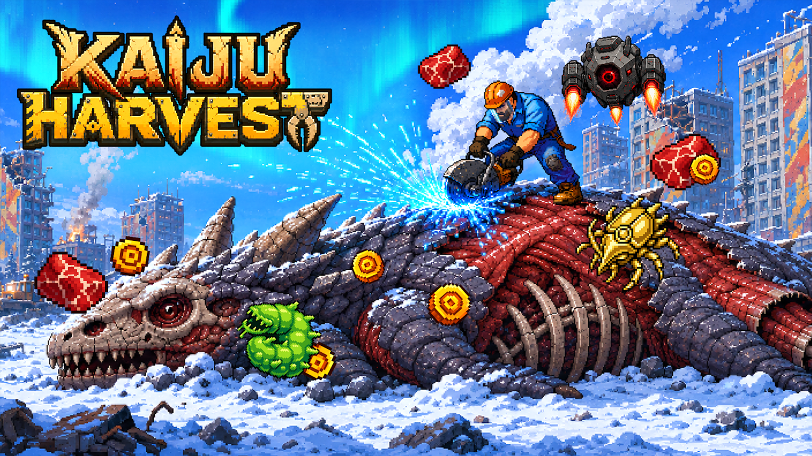

## 1막 · [중간 제목]

Q. 팀 소개를 부탁드립니다.

[답변 — 인터뷰이의 말투를 살린 2~4문장. 한 문단이 너무 길면 나눠 씁니다.]

Q. 스트리머 콜라보를 신청하게 된 계기가 궁금해요.

[답변 첫 문단]

[답변 둘째 문단 — 질문 다음에 오는 문단은 모두 같은 답변으로 묶입니다.]

> [인터뷰에서 가장 인상적인 한 마디를 크게]

Q. 방송을 보면서 가장 기억에 남는 순간은요?

[답변]

## 2막 · [중간 제목]

Q. 콜라보 이후 게임에 반영한 피드백이 있나요?

[답변]

[영상 — 유튜브 주소(https://youtu.be/영상ID 형태)를 이 자리에 한 줄로만 붙여넣으면 영상 플레이어로 바뀝니다]

Q. 마지막으로 하고 싶은 말이 있다면?

[답변]
