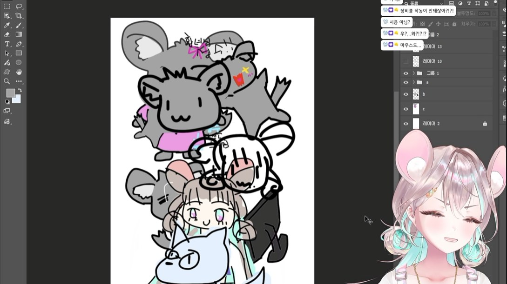

## 1막 · 문을 열며

Q. 처음 만나는 분들께 자기소개 부탁드려요.

스하! 안녕하세요, 저는 치지직에서 방송하고 있는 베넷제국 막내 황녀, 친칠라 수인 스노하라 스나라고 합니다. 제국이 너무 시시해서 가출을 했는데, 여기가 너무 좋아서 방송도 하고 황위까지 포기하고 계속 눌러살게 된 스트리머예요!

방송은 노래, 토크, 게임까지 다 하는데, 그중에서도 토크하면서 게임하는 걸 제일 좋아해요. 잘 부탁드립니다!

Q. '스노하라 스나'라는 이름은 어떻게 탄생했나요?

처음에 캐릭터를 정할 때 주변에서 제가 친칠라를 닮았다고 하더라고요. 그런데 친칠라는 목욕을 모래로 한대요. 모래가 일본어로 '스나(砂)'잖아요? "어, 그럼 이름을 스나로 할까?" 해서 이름이 먼저 정해졌어요(웃음).

그다음엔 성을 뭐로 할지 한참 고민했어요. 머리를 굴리면서 "스나, 스나, 스나…" 하고 있는데, 주변 분이 '스나'랑 라임이 딱 맞는 '스노하라'는 어떠냐고 추천해 주셨어요. "어? 그럴까?" 하고 그대로 정해졌답니다.

Q. 방송을 처음 켜던 날을 기억하나요?

진짜 생생하게 기억나요! 저는 서브컬처를 좋아하는 평범한 사람이었어요. 버츄얼 초창기부터 버츄얼이라는 걸 정말 해 보고 싶었거든요. 사람들이랑 소통하고, 재밌게 이야기도 나누고, 서로 위로도 해 주면서 다양한 방송을 할 수 있을 것 같았어요. 그 꿈이 현실이 된 거죠.

그런데 데뷔 4일 전에 사건이 하나 있었어요. 리허설 방송을 해 보려다가 실수로 진짜 방송을 켜 버린 거예요! 2분쯤 지나니까 채팅이 올라오기 시작해서, "어?!" 하고 바로 껐어요. 식은땀이 줄줄 나더라고요.

그리고 진짜 데뷔 날, 방송을 켜자마자 채팅이 우르르 올라오는데 머리가 하얘져서 대본도 하나도 안 보였어요. 덜덜 떨렸는데, 이상하게 기분은 너무 좋은 거예요. "이렇게 와 주시다니, 정말 고맙다. 이분들이랑 이야기 많이 하면서 방송하면 너무 재밌겠다" 하면서 가슴이 콩닥콩닥했어요.

> 식은땀은 줄줄 나는데 기분은 너무 좋고, 도파민이 샘솟는 환상적인 기분이었어요.

## 2막 · 세상 속으로

Q. 처음 오는 분께 "내 방송은 이런 곳"이라고 소개한다면요?

한마디로 하면, 기분이 안 좋은 날에도 들어오면 기분이 좋아지는 방송이요!

저희 방송은 텐션이 정말 높고 시청자분들과 티키타카 장난도 많이 쳐요. 사실 제가 거의 탱커예요(웃음). 맨날 시청자분들한테 바보라는 소리 듣고, 꼬질꼬질하다, 키가 작다 이런 소리를 들으면서 투닥투닥하거든요. 저는 게임을 잘한다고 생각하는데 다들 못한대요. 그래서 "아니, 내가 증명할 수 있다니까!" 하다가 또 훈수를 받고요.

그렇게 다 같이 참여하는 분위기에서, 친구처럼 편하게 대화할 수 있는 방송을 하고 있어요.

Q. 캐릭터의 세계관과 설정(RP)을 소개해 주세요.

저는 베넷제국의 막내 황녀, 친칠라 수인이에요. 세상 말괄량이에 막내라서 사랑을 가득가득 받고 자랐거든요. 그래서 "내가 다 옳다, 난 최고야!" 하는 황녀님이에요(웃음).

그런데 제국이 너무 심심해서, 더 넓은 세상을 보려고 가출을 했어요. 그렇게 대한민국까지 와서 방송을 시작하게 된 거죠. 말하자면 가출 방랑 중인 황녀예요.

Q. 시청자를 부르는 애칭이 있나요?

들으시면 놀라실 수도 있는데요… '천민'이에요!

데뷔했을 때는 팬 이름이 없어서, 방송을 며칠 하다가 "얘들아, 팬 이름 정해 보자!" 하고 의견을 받았어요. 노예, 조공즈, 천민… 정말 다양한 후보가 나왔는데, 그중에서 투표를 했더니 천민이 압도적으로 많이 나왔어요. 그렇게 천민이 탄생했답니다.

Q. 스나 방송에서만 볼 수 있는 콘텐츠가 있다면요?

가끔 천민들을 위해 제가 직접 그림을 그려 주는 방송을 해요.

그리고 제가 운전을 굉장히 잘한다고 생각하거든요(웃음). 그래서 '유로 트럭 시뮬레이터 2', '포르자 호라이즌'같은 운전 게임을 하면서 천민들이랑 소통을 많이 해요. 여자 스트리머분들이 잘 안 하는 콘텐츠죠. 1년에 한 번씩은 군대 썰 사연을 받아서 풀어 보는 콘텐츠도 하고 있어요.

Q. 지금까지 방송하면서 가장 기억에 남는 해프닝은요?

데뷔 전 실수로 방송을 켠 일 말고 하나 더 있어요. 저는 페이셜 트래킹용 아이폰을 따로 쓰는데, 365일 충전기에 꽂아만 뒀거든요. 그런데 어느 날 방송을 켜고 페이셜을 연결하려는데 폰이 아예 안 켜지는 거예요. 그래서 2주 동안 버츄얼 아바타 없이 방송을 했어요. 그때는 정말 당황했는데, 지금 생각하면 그것도 재밌는 추억이에요.

Q. HGE Creator 콜라보로 플레이한 게임 중 기억에 남는 게임은요?

'얀데레 바이러스'요! 제가 미츄 스트리머분들 방송을 정말 즐겨 보거든요. 그래서 살짝 덕질하는 마음으로 플레이할 수 있었어요. 좋아하는 분들의 목소리로 대사를 들을 수 있다니, 무서워도 이건 해야지! 하면서 했어요(웃음). 

## 3막 · 다음 장으로

Q. 앞으로 시청자들에게 어떻게 기억되고 싶나요?

늘 밝고, 같이 웃을 수 있고, 같이 장난칠 수 있는 친구 같은 스트리머로 기억되고 싶어요. 그리고 한 대 콩! 쥐어박고 싶은 여동생 같은 친칠라였으면 좋겠어요(웃음). 앞으로도 많이 사랑받고 싶고, 다 같이 행복하게 소통할 수 있으면 좋겠어요.

> 늘 밝고, 같이 웃고 장난칠 수 있는 친구 같은 스트리머로 기억되고 싶어요.

Q. 언젠가 꼭 해보고 싶은 꿈의 방송이 있다면요?

미니 콘서트를 하고 싶어요. 노래 부르는 것도 좋아하고, 친구들이랑 노는 것도, 공연 보는 것도 좋아하거든요. 그걸 천민들이랑 같이 즐기면 얼마나 좋겠어요? 아직 오리지널 곡은 없지만, 오리지널 곡과 커버 곡으로 한두 시간 정도 미니 콘서트를 꾸준히 여는 게 목표예요.

https://www.youtube.com/watch?v=raImjxJiKIg

Q. 이 인터뷰를 읽고 있을 천민들에게 한마디 해주세요.

천민들아, 앞으로도 스나의 발닦개 역할 잘하도록 하렴! 우리 많이 많이 같이 놀고, 즐기고, 서로 다독여 주는 그런 사이가 되자. 잘 부탁해, 얘들아. 많이 아낀다!
