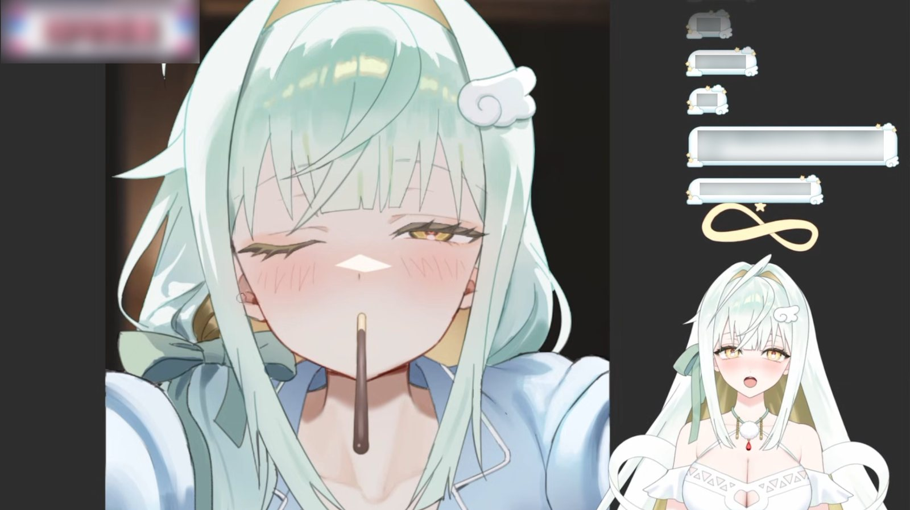

## 1막 · 문을 열며

Q. 처음 만나는 분들께 자기소개 부탁드려요. 방송에서 쓰는 인사말 그대로요!

"여신강림이라! 잘하잘하!"

방송을 시작할 때는 이렇게 인사해요. 저는 70억 살 창조의 여신이고요, 옆집 누나 같은 친근함이 있는 빙구 누나입니다. 70억 살인데 빙구예요(웃음). 어디까지 소개를 해야 하지?

요즘에는 아침 8시부터 12시까지, 그리고 밤 8시부터 12시까지 방송하는 전업 스트리머로 살고 있어요.

Q. '잘님'이라는 이름에는 어떤 이야기가 담겨 있나요?

이건 제 친구들이 많이 관여했는데요. 혹시 '존잘님'이라는 단어 아세요?(웃음) 그림을 잘 그리거나 능력이 출중한 사람을 부르는 말이에요.

제가 그림을 그리다 보니까, 친구들이 자신감을 북돋아 주려고 저를 "존잘님, 존잘!" 하고 불러 줬거든요. 그래서 "그럼 나 잘님이라고 할까?" 해서 잘님이 됐답니다.

Q. 방송을 처음 켠 날을 기억하나요?

처음에는 방송을 거창하게 할 생각이 없었어요. 그냥 한번 해 볼까 하고 아무 준비도 없이 켜 버렸거든요. 육체, 그러니까 아바타도 대충 마련했고, 마이크도 흔히 '어항 소리가 난다'고 하는 어항 음질로 시작해서 정말 엉망진창이었어요.

주로 친구들이 와서 봐 줬는데, 아무도 안 올 줄 알았던 방송에 처음 보는 분들이 와 주셨어요. 그게 너무 신기해서 다음 날에도 켜게 됐죠. 첫날은 게임을 했고, 2일 차부터는 저챗(소통 방송)을 했는데 그때도 사람들이 꽤 많이 와 주셨어요.

대화하는 게 너무 재밌더라고요. '이거 나랑 잘 맞는다' 싶었어요. 그렇게 하다 보니 1년이 넘고, 데뷔까지 하게 됐답니다.

## 2막 · 세상 속으로

Q. 처음 오는 분께 "내 방송은 이런 곳"이라고 소개한다면요?

저는 소통을 제일 중요하게 생각하는 방송을 해요. 편안한 분위기 속에서, 무엇보다 '이해받고 있다'는 느낌을 받을 수 있는 방송이에요. 그리고 언제든 다시 돌아올 수 있는 방송을 지향하고 있어요. 이 정도면 되나요?(웃음)

https://www.youtube.com/watch?v=ZE-gYSHtytY

Q. 캐릭터의 세계관과 설정(RP)을 소개해 주세요.

저는 70억 살 창조의 여신인데, 이 세상이 아닌 다른 세계의 창조의 여신이에요. 그러니까 이 세상을 제가 만든 건 아니에요.

제가 있던 세계는 멸망했어요. 그래서 상심한 나머지 창조의 권능을 잃어버렸죠. 그런데 지구에 와 보니 인간들이 너무 재미있어 보이는 거예요. 그래서 인간들과 함께 지내기 위한 30대 정도의 인간계 육체가 따로 있어요(웃음).

그리고 인간과의 계약을 통해 '잘자'라는 시청자들을 만들어요. 잘자들에게 인간의 이야기를 가져와 달라고 부탁하고, 그 이야기를 들으면서 인간을 이해하고 힐링하면서 잃어버린 권능을 조금씩 되찾아 가는 설정이에요.

---

*편집자 주* — 지금까지 HGE Universe가 만난 크리에이터 가운데 최고령이다. 무려 70억 살.

Q. 시청자를 부르는 애칭이 있나요?

'잘자'예요. 저의 피조물이니까 뭔가 저랑 비슷한 느낌, 저의 분신 같은 느낌이었으면 했어요. 그래서 시청자분들께 "우리 이름 뭐로 할까?" 하고 물어봤는데, "잘자 어때요?"라는 말이 나왔어요.

'잘 자라'는 의미도 담겨 있더라고요. 제가 처음에는 편안하게 듣다가 잠들 수 있는 방송을 하고 싶었거든요. "잘 자라, 우리 아가" 할 때 그 '잘 자'예요(웃음). 그렇게 잘자가 됐답니다.

Q. 잘님 방송에서만 볼 수 있는 콘텐츠가 있다면요?

제가 창조의 권능을 쓰다 보니까(웃음), 여러 가지 창작 활동을 하는데요. 그중에서도 그림이 제일 특기예요. 그래서 방송에 쓰이는 굿즈와 일러스트를 전부 제가 손수 그리는 작업 방송을 해요.

그림이 그려지는 과정을 처음부터 끝까지 보실 수 있고, 때로는 채팅으로 직접 참여하실 수도 있어요. "이런 거 붙여 주세요, 이것도 추가해 주세요!" 하고 참견하실 수 있죠. 가끔 그림에 대해 질문하시면 짧게 강좌를 해 드리기도 해요.

Q. 지금까지 방송하면서 가장 기억에 남는 해프닝은요?

정말 최근 일인데요. 올해 10월 할로윈에 벌칙을 했거든요. 고양이 코스프레를 하고 편의점에 가서 "냥냥" 거리면서 '솔의 눈' 음료를 사 먹는 미션이었어요.

그날 일단 벌칙 자체가 굉장히 부끄러웠고요(웃음). 
응원해주고 반응해주는 팬들을 보니, '아, 얘네가 진짜 AI가 아니라 사람이구나' 하는 느낌도 들면서, 시청자들을 향한 애틋한 마음이 많이 자랐던 것 같아요.

> 응원해주고 반응해주는 팬들을 보니 시청자들을 향한 애틋한 마음이 많이 자랐어요.

## 3막 · 다음 장으로

Q. 앞으로 시청자들에게 어떻게 기억되고 싶나요?

어디 갔다가 돌아와도 한결같은, 고향 같은 스트리머가 되고 싶어요. 그리고 어떤 이야기든 편견 없이 들어 주는 사람이라는 인상을 남기고 싶어요.

물론 저는 신이지만(웃음), 인격 대 인격으로 만날 수 있는 그런 스트리머가 되고 싶습니다.

> 물론 저는 신이지만, 어떤 이야기든 편견 없이 들어 주는 고향 같은 스트리머가 되고 싶어요.

Q. 언젠가 꼭 해 보고 싶은 방송이나 콘텐츠가 있다면요?

저는 하고 싶은 콘텐츠가 명확한데요. 제가 노래를 잘 못하거든요(웃음). 그래도 창작 뮤직비디오를 꼭 만들어 보고 싶어요.

저는 그림으로 참여하고, 애니메이션 하시는 분, 노래하시는 분들을 모아서 버추얼 스트리머와 아티스트분들의 합작을 발표하고 싶어요. 그렇게 버추얼의 저변을 넓히면서 새로운 분들을 발굴하고 싶다는 마음이 있어요. 저도 그분들과 합작하면서 좋은 영향을 많이 주고받는, 그런 존재가 되고 싶어요.

Q. 이 인터뷰를 읽고 있을 잘자들에게 한마디 해주세요.

잘자들아, 나 인터뷰 탔어! 너네 몰랐지?

앞으로도 변함없이 항상 빙구 같지만, 그래도 발전하는 모습을 보여 줄 테니까. 지금까지 그래 왔듯이 우리 서로 사랑하면서 잘 지내 보자. 사랑해!
